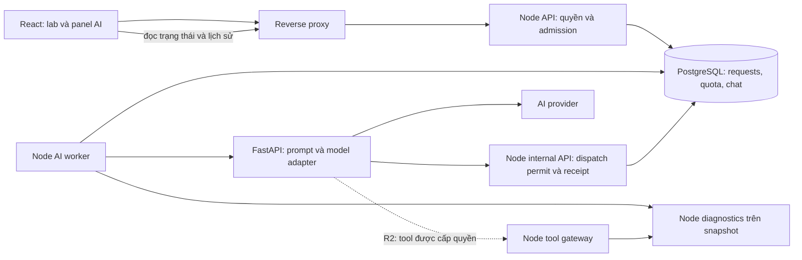
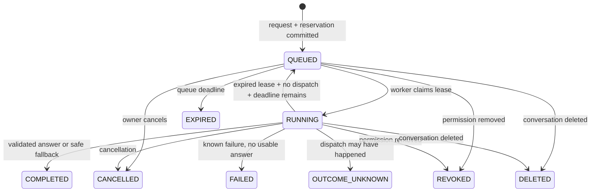

# 02 — Kiến trúc, dữ liệu và hợp đồng API

[Về kế hoạch tổng](README.md) · [Sản phẩm](01-product-and-learning.md) · [Backlog](03-delivery-backlog.md) · [Kiểm thử/vận hành](04-quality-and-operations.md)

**Chốt ADR-01 ngày 19/10/2026:** wire contract v1.0.0, state machine, error map và fixtures nằm tại [src/agent/contracts/ai-lab/v1](../../src/agent/contracts/ai-lab/v1/README.md); nguồn schema duy nhất là [shared Zod module](../../src/agent/contracts/aiLabContract.js), đã kiểm cùng fixtures trên frontend/Node/Python. Các endpoint/service/migration AI bên dưới vẫn là thiết kế để triển khai ở các task sau. Khi ví dụ/ghi chú cũ khác artifact versioned, dùng artifact và ADR đã chốt.

## 1. Kiến trúc đích



Ba tiến trình ứng dụng: Node API, Node worker và Python AI service. Node API/worker dùng chung codebase và migration, có thể build từ cùng image nhưng chạy entrypoint khác. Worker được tách khỏi HTTP server để chủ động giới hạn số tác vụ, drain khi deploy và không kéo dài HTTP từ browser. Python không có credentials đọc database nghiệp vụ.

### 1.1. Ranh giới trách nhiệm

| Lớp | Sở hữu | Không được trở thành nguồn quyết định |
|---|---|---|
| React | UI, bản nháp trong tab, clientRequestId, query cache theo user, poll | Quyền user, quota, trạng thái mạng gửi cho AI |
| Node API | JWT hiện hành, membership, eligibility, context snapshot, request admission | Nội dung model được tin chỉ vì response là JSON |
| Node worker | Claim job, lifecycle, deterministic diagnostics, orchestration R1, settlement | Tự retry provider khi không biết lần trước đã được nhận |
| Node domain/tool gateway | Simulator facts, check evidence, command capability, clone-only simulation | LLM tự xác nhận nguyên nhân hoặc ghi state/score |
| Python | Prompt/policy version, provider adapter, schema output, orchestration R2 | Truy cập user/hidden rubric hoặc thay entitlement |
| PostgreSQL | Lịch sử bền vững, unique constraints, reservations, dispatch ledger | Bộ nhớ tạm không có retention hoặc backup |
| Provider | Sinh diễn giải/hypothesis theo dữ liệu được cấp | Tính điểm, quyết định quyền, xác nhận thanh toán nội bộ |

### 1.2. ADR cần lưu khi triển khai

| ADR | Quyết định mặc định | Trigger xem lại |
|---|---|---|
| [ADR-001](adr/ADR-001-async-api.md) | API bất đồng bộ, poll trạng thái; chỉ render output sau validate | Khi polling gây tải lớn hoặc có nhu cầu progress real-time mới đánh giá SSE |
| [ADR-002](adr/ADR-002-postgres-queue-quota.md) | PostgreSQL queue + quota transaction | Lock latency/DB CPU/queue backlog vượt mục tiêu ở tải thực; benchmark trước khi chuyển queue |
| [ADR-003](adr/ADR-003-provider-policy.md) | Một provider/model đã eval cho R1, fallback xác định; hãng/model chọn ở OPS-00/AI-02 | Cần thêm provider vì availability/giá; mỗi cấu hình mới phải qua eval và policy dữ liệu |
| [ADR-004](adr/ADR-004-node-facts-ownership.md) | Node deterministic diagnostics; Python dùng facts | Nếu chuyển engine sang công nghệ khác phải có migration domain riêng |
| [ADR-005](adr/ADR-005-orchestration-contract-source.md) | R1 không dùng framework agent; một nguồn schema, R2 có spike riêng | Chọn theo nhu cầu tool loops/checkpoint và khả năng duy trì một người |
| [ADR-006](adr/ADR-006-validated-output.md) | Không stream token chưa kiểm tra tới người học | Nếu thêm streaming, chỉ stream status hoặc block đã validate; cần thiết kế revocation và output safety mới |
| [ADR-007](adr/ADR-007-receipts-accounting.md) | Tách request result khỏi provider-call accounting | Bắt buộc giữ cả khi hủy/xóa/quyền bị thu hồi; tránh mất chi phí thật |

PostgreSQL mô tả `SKIP LOCKED` phù hợp cho nhiều consumer của bảng kiểu queue, đồng thời cảnh báo nó không phù hợp cho đọc dữ liệu tổng quát cần nhất quán. Kế hoạch chỉ dùng nó để claim job; quota vẫn dùng transaction/locks rõ ràng. [Tài liệu PostgreSQL 16](https://www.postgresql.org/docs/16/sql-select.html#SQL-FOR-UPDATE-SHARE)

FastAPI có cơ chế background tasks trong process; tài liệu cũng phân biệt nhu cầu chạy qua nhiều process/server. Thiết kế ở đây dùng request ledger và worker bên ngoài để phục hồi sau restart, không dùng background task trong web process làm nơi duy nhất giữ trạng thái job. [Tài liệu FastAPI](https://fastapi.tiangolo.com/tutorial/background-tasks/#caveat)

## 2. Các bất biến phải kiểm thử

1. Một `(userId, clientRequestId)` ánh xạ tới một request bất biến; đổi payload cùng key bị từ chối.
2. Một request có tối đa một user message và một assistant message; replay HTTP không tạo thêm.
3. Không gọi provider trước khi commit request, quota reservation và dispatch authorization.
4. Một provider call chỉ nhận một dispatch permit. Không tuyên bố “exactly once” cho hệ thống bên ngoài khi không có cam kết tương ứng từ provider.
5. Tổng `spent + reserved` không vượt hạn mức admission đã đặt; usage thiếu không được coi bằng 0.
6. Không giữ transaction/khóa attempt trong lúc gọi HTTP, chờ provider, sleep hoặc retry.
7. Context luôn lấy từ snapshot server; từng fact có nguồn, revision và tool/diagnostic version.
8. Không đưa hidden gradingSpec/expected, lời giải, credentials hay lịch sử user khác vào Python.
9. Mọi API đọc status/history/feedback và mọi tool đều kiểm quyền hiện tại; biết UUID không tạo quyền.
10. Chạy AI không làm đổi deviceState, ARP/MAC/NAT cache thật, số lệnh, score hoặc progress thật.
11. Response cũ không xuất hiện sau logout, đổi tài khoản, xóa hội thoại hoặc thu hồi quyền.
12. AI lỗi không khiến lab core hoặc readiness của toàn bộ nền tảng bị coi là hỏng.

## 3. Vòng đời request R1

### 3.1. Nhận yêu cầu

1. Xác minh JWT, trạng thái user, sessionVersion; validate size, schema và intent.
2. Kiểm user có quyền attempt + lab policy hiện tại + cohort AI. Với conversation, kiểm đúng owner và epoch chưa bị xóa.
3. Tra `(userId, clientRequestId)` **trước khi so revision hiện tại**. Request cũ hợp lệ trả cùng resource dù lab đã đổi; payload khác trả `409 AI_IDEMPOTENCY_CONFLICT`.
4. Với request mới, kiểm `recoveryEpoch` từ capabilities còn hiệu lực; sau restore, epoch cũ không được tạo paid call mới. Trong transaction ngắn, lấy khóa attempt theo cơ chế hiện có, đọc definition/state/status/membership, kiểm `expectedRevision`, thiết bị và task. Tính public progress trên clone có giới hạn kích thước.
5. Khóa/upsert các budget bucket theo thứ tự cố định; kiểm rate, quota, global budget và slot user. Reserve phần chi phí tối đa cho request.
6. Lưu snapshot đã lọc, request `QUEUED`, user message, reservation và outbox event trong cùng transaction. Snapshot và context hash không còn thay đổi sau commit.
7. Trả `202 Accepted` + request ID + URL đọc status. Không đợi model trong request browser.

Trước pilot phải đo transaction snapshot/quota: mục tiêu p95 <150ms trên lab được chứng nhận. Nếu quá lớn, giảm supported topology hoặc tách tính toán ra clone ngoài transaction với kiểm lại revision; không tăng timeout để che một transaction giữ khóa lâu.

### 3.2. Worker và lời gọi Python

1. Worker claim request bằng `FOR UPDATE SKIP LOCKED`, ghi `workerId`, `leaseUntil`, tăng `leaseVersion`, chuyển `RUNNING`; commit ngay.
2. Kiểm lại user, sessionVersion, membership, conversation epoch, feature flag và deadline. Chạy diagnostics trên snapshot đã lưu.
3. Tạo `AiProviderCall` ở `PLANNED` với `callId`, `stepIndex=0`, budget và scoped permit. R1 chỉ có một call sinh câu trả lời.
4. Gửi Python context đã lọc + facts + permit. Python validate contract và context limit; không có thông tin truy vấn DB tùy ý.
5. Trước khi gọi provider, Python gọi Node internal endpoint để claim permit. Node atomically đổi `PLANNED → DISPATCHED`, kiểm lease/current authorization/epoch/budget. Claim lặp bị từ chối, kể cả qua replica khác.
6. Python thực hiện đúng một lời gọi có deadline; SDK retry tự động và retry POST ở proxy bị tắt. Chỉ retry trước dispatch khi chứng minh chưa có lời gọi trả phí.
7. Python validate sơ bộ và gửi receipt (usage, provider ID, output có giới hạn, version, hash) về Node bằng endpoint idempotent; sau đó trả kết quả cho worker. Node kiểm tình trạng revoke/delete trước khi giữ raw output: khi không còn quyền lưu nội dung, chỉ nhận metadata usage cần đối soát và bỏ phần text. Có thể retry gửi receipt vì đây là thao tác ghi idempotent, không gọi lại model.
8. Node kiểm cấu trúc, evidence, device/task/command references, hint policy, versions và context hash. Tái kiểm quyền/epoch trước lưu output hiển thị.
9. Ghi assistant message hoặc fallback, terminal status, usage settlement và outbox trong transaction ngắn. Đọc `currentRevision` để đánh dấu stale, không đổi source snapshot.

Receipt bảo vệ trường hợp response worker↔Python bị mất sau khi model hoàn thành. Nếu receipt cũng mất hoặc Python chết sau dispatch, hệ thống vẫn có thể không biết outcome; áp dụng quy tắc unknown bên dưới.

### 3.3. State machine



`responseMode` tách khỏi state: `LLM`, `DETERMINISTIC`, `NONE`. `OUTCOME_UNKNOWN` có thể kèm một fallback xác định đã duyệt, nhưng không được ghi là câu trả lời của model. Terminal request không được worker cũ ghi đè; receipt đến muộn chỉ cập nhật accounting/reconciliation, không thêm một câu trả lời thứ hai.

| Tình huống | Có được retry tự động? | Xử lý dữ liệu/chi phí |
|---|---|---|
| Browser mất response POST | Có, cùng clientRequestId | Trả request cũ, không reserve/gọi lại |
| Worker chết khi `QUEUED` hoặc chưa tạo/claim call | Có, sau lease và kiểm trạng thái call | Claim mới dùng fence tăng; còn đủ deadline mới chạy |
| Python từ chối schema trước claim permit | Không cần gọi lại model | Sửa lỗi hệ thống, release chi phí chưa dùng, fallback |
| Claim permit thành công nhưng acknowledgement mất | Không tự gọi lại provider | `OUTCOME_UNKNOWN`, giữ cost reservation; có thể thực tế chưa tốn tiền |
| Provider có kết quả, receipt đã lưu, worker response mất | Không gọi lại model | Finalizer đọc receipt và hoàn tất đúng một lần |
| Timeout sau dispatch hoặc worker/Python chết | Không retry model tự động | Unknown outcome, reconcile; UI có thao tác yêu cầu mới riêng |
| Provider trả 429 trước sinh output, adapter xác nhận không tính usage | Theo policy provider đã kiểm chứng, mặc định không | Lưu known failure; release nếu chắc không phát sinh; không suy rộng mọi 429 đều miễn phí |
| User hủy trước dispatch | Không | Release reservation/unit và giữ audit metadata |
| User hủy sau dispatch | Không | Cố abort; chi phí có thể vẫn phát sinh, settle hoặc unresolved; không hứa hoàn phí provider |
| Quyền bị thu hồi/xóa hội thoại | Không | Chặn output/tool tiếp theo, discard nội dung muộn, vẫn ghi accounting |

### 3.4. Lease, fencing và khóa

- Lease worker khởi điểm 15 giây, heartbeat 5 giây; leaseVersion tăng mỗi lần claim hợp lệ.
- Mỗi cập nhật lifecycle cần đúng request ID + leaseVersion + expected state. Lease mất không cho phép dispatch provider mới.
- Reaper chỉ requeue khi chứng minh call chưa được claim. Với `DISPATCHED`, reaper chuyển unknown sau deadline/grace period và khởi động reconciliation.
- Global execution slots là các row `AiExecutionSlot` dùng chung, không dùng biến RAM mỗi worker. Worker claim slot trống bằng transaction ngắn; khi giảm concurrency chỉ ngừng cấp các slot vượt mức mới, không xóa slot đang chạy. Slot cho call chưa rõ kết quả giữ tới hết execution deadline + grace; budget unresolved giữ lâu hơn.
- Thứ tự khóa thống nhất: attempt → conversation → request/user execution slot → quota buckets theo key → reservation/provider call. Luồng finalize/cancel đi theo cùng thứ tự khi cần nhiều nhóm khóa.
- Không giữ lock trong khi chờ poll, network hoặc diagnostics tốn nhiều CPU. Snapshot nhỏ được chứng nhận có thể tạo dưới lock; engine computations dài chạy trên clone đã lưu.

## 4. Chính sách quota và ngân sách

### 4.1. Giới hạn khởi điểm cần benchmark

| Cấu hình | Giá trị đề xuất pilot | Cách dùng |
|---|---|---|
| User concurrent request | 1 request QUEUED/RUNNING trên toàn user | Tránh nhiều tab mở đồng thời làm tăng chi phí |
| Rate gửi yêu cầu mới | 6 request/phút/user | Store chung; retry ID cũ không tiêu thêm AI unit, vẫn chịu bảo vệ HTTP |
| Quota chất lượng trả lời | 20 câu trả lời LLM/ngày/user | Reserve unit khi nhận; refund khi không có câu trả lời dùng được; reset UTC hiển thị theo local |
| Global provider concurrency | 4 ở pilot; thử 8 cho cohort lớn | Tính theo hạn mức provider và kết quả load test, không nhân theo replica |
| Queue length | Tối đa 2 × global concurrency | Queue đầy → 503 capacity; tránh chờ vô hạn |
| Queue wait | Tối đa 10 giây | Quá hạn trước dispatch → EXPIRED, release |
| Provider generation deadline | 20 giây | Được adapter map đúng vào timeout; cancel có thể không dừng billing |
| End-to-end request budget | 35 giây | Bao gồm queue + model + validation/persist; target p95 nhanh hơn |
| Question length | 2.000 ký tự; kiểm thêm byte limit | Reject 400/413, không cắt lặng lẽ nội dung câu hỏi |
| Context payload | 64 KiB; input model tổng tối đa 6.000 token | Đếm bằng tokenizer của adapter trước dispatch |
| Output budget | Tối đa 800 token trả lời, answer text 6.000 ký tự | Nếu model có reasoning token tính phí, phải có cap riêng hoặc không chọn cấu hình đó |
| Recent commands | Tối đa 12 lệnh và phần output có liên quan | Redact/truncate có metadata |
| Chat history vào model | Tối đa 6 messages đã lọc trong conversation | Không coi fact lịch sử là sự thật hiện tại |

Những giá trị này không chứng minh đủ tải cho lớp học. Nếu provider quota nhỏ hơn, admission sử dụng giới hạn nhỏ hơn. Đơn vị tiền nội bộ là số nguyên micro-USD, lưu currency và bảng giá có version; quy đổi VND chỉ dùng cho báo cáo, không tính bằng float.

### 4.2. Reservation và settlement

Tại admission, reserve tối đa `max_input_tokens × input_price + max_chargeable_output × output_price + các phí bắt buộc khác` cho cấu hình đang chọn. Reserve đồng thời bucket chi phí user/ngày, global/ngày, global/tháng và unit user/ngày. Không dùng token trung bình để cho phép request vượt cap.

Tại completion, ghi một settlement event duy nhất theo call/request; chuyển reserved sang spent theo usage thực, trả phần còn lại. Nếu adapter không xác nhận usage, giữ `UNRESOLVED`; không ghi 0 token. Sau tối đa 24 giờ cần đối soát hoặc book mức reserved như chi phí ước tính để tiếp tục giữ budget bảo thủ. Dữ liệu thực đến sau tạo adjustment có ID riêng, không sửa lịch sử ledger không dấu vết.

Quota UI cho biết câu trả lời còn lại và lượt đang giữ chỗ. Câu trả lời hợp lệ nhưng stale vẫn sử dụng một unit vì đã xử lý snapshot người học yêu cầu; ghi rõ trong UX và cho kiểm tra lại bằng request mới. Fallback xác định không trừ unit LLM; các request thất bại vẫn chịu rate limit chống spam và mọi chi phí provider thật vẫn được tính vào budget.

Bucket được lock theo thứ tự cố định, dùng transaction và điều kiện `spent + reserved + new <= limit`. Có unique settlement/reservation để hai worker không hoàn tiền hai lần. Lỗi store quota → fail closed cho AI có phí, lab core vẫn hoạt động.

## 5. Mô hình dữ liệu đề xuất

Đây là mô hình logic để triển khai Prisma + SQL migrations. Không sao chép nguyên ví dụ ba bảng của bản đề xuất ban đầu vì chúng chưa đủ quản lý pending requests, quota và kết quả chưa rõ.

**Đã triển khai lưu trữ local 23/10/2026:** [BE-01](baseline/BE-01-storage.md) có 11 model R1, nullable metadata, partial unique active request và SQL checks; DB mới/nâng cấp, schema diff và client cũ đã kiểm. Bản Prisma dùng `ownerKey` để giữ dedup sau tách identity, `requestedHintLevel`/`effectiveHintLevel`, composite FK request/conversation/epoch và call/contextHash. Tiền dùng BigInt micro-USD. Bảng dưới vẫn mô tả cả hành vi runtime sẽ triển khai ở BE-02/03/04/07/08; migration chưa áp vào DB ứng dụng.

| Bảng/model | Trường chính | Ràng buộc và index |
|---|---|---|
| `AiConversation` | UUID, userId, attemptId, epoch, createdAt, updatedAt, deletedAt | Unique `(userId, attemptId)`; epoch tăng khi xóa/reset; không cấp quyền qua relation đơn thuần |
| `AiRequest` | UUID, userId, attemptId, conversationId, conversationEpoch, recoveryEpoch, clientRequestId, payloadHash, status, responseMode, intent, hintLevel, sourceRevision, snapshot, contextHash, versions, sessionVersionAtAdmission, deadlineAt, lease fields, errorCode, timestamps | Unique `(userId, clientRequestId)`; index `(status, createdAt)` và `(userId, createdAt)`; partial unique user đang QUEUED/RUNNING; snapshot nullable sau purge |
| `AiMessage` | UUID, conversationId, epoch, requestId, role, content/structuredAnswer, sourceRevision, evidenceRefs, evidenceSnapshot tối thiểu, createdAt | Unique `(requestId, role)`; role enum USER/ASSISTANT; index `(conversationId, epoch, createdAt, id)` cho cursor |
| `AiProviderCall` | UUID, requestId, stepIndex, provider, model, priceVersion, dispatch state, leaseVersion, providerRequestId, tokens, costMicros, usageStatus, receiptHash, receiptPayload tạm, receiptExpiresAt, suppressionReason, timestamps | Unique `(requestId, stepIndex)` R1 step=0; dispatch CAS một lần; usage nullable khi unknown; raw receipt bị purge độc lập |
| `AiQuotaBucket` | scopeType, scopeKey, windowStart, windowEnd, limitUnits, usedUnits, reservedUnits, limitMicros, spentMicros, reservedMicros | Unique `(scopeType, scopeKey, windowStart)`; check giá trị không âm; PostgreSQL time làm chuẩn |
| `AiReservation` | requestId, bucketId, units, costMicros, status, settledAt | Unique `(requestId, bucketId)`; settlement idempotent, foreign keys rõ |
| `AiUsageAdjustment` | UUID, providerCallId, idempotencyKey, deltaMicros, reason, createdAt | Unique idempotencyKey; chỉnh reconcile không xóa số liệu cũ |
| `AiExecutionSlot` | environment, slotNumber, requestId nullable, callId nullable, leaseVersion, acquiredAt, expiresAt | Unique `(environment, slotNumber)`; conditional claim; không giải phóng slot đang xử lý chỉ vì worker restart |
| `AiRuntimePolicy` | environment, version, admissionEnabled, dispatchEnabled, eligibilityRules, limits, providerConfigId, updatedAt, updatedBy | Một policy hiện hành/environment; audit thay đổi; permit kiểm lại flag hiện hành trong DB, không chỉ env cache của process |
| `AiFeedback` | messageId, userId, helpful, reasonCode, optionalComment, createdAt/updatedAt | Unique `(messageId, userId)`; chỉ owner conversation; comment có retention |
| `AiEventOutbox` | eventId, type/version, payload không chứa text, occurredAt, exportedAt, retryCount | Unique eventId; index chưa exported; exporter dedup |
| `AiToolCall` — R2 | requestId, stepIndex, toolCallId, name/version, argumentsHash, sourceRevision, evidence, status, latencyMs | Unique toolCallId; scope binding; log tối thiểu, không chứa secret |

`versions` phải gồm contextSchemaVersion, simulatorVersion, diagnosticVersion, promptVersion, policyVersion, provider/modelVersion, priceVersion, app commit và toolsetVersion khi có. Một message hiển thị cần truy ngược được request/call/versions mà không cần log toàn prompt.

`evidenceSnapshot` trong message chỉ giữ fact đã hiển thị và provenance tối thiểu cùng thời hạn chat; full safe request snapshot được purge sớm hơn. Nhờ vậy người học vẫn đọc được bằng chứng của câu trả lời cũ sau khi context debug đã hết hạn. Xóa message sẽ xóa cả evidence excerpt; không để một bản sao nội dung nằm ngoài retention.

Provider-call state: `PLANNED`, `DISPATCHED`, `RECEIVED`, `KNOWN_FAILURE`, `OUTCOME_UNKNOWN`. Usage status độc lập: `PENDING`, `FINAL`, `UNRESOLVED`, `ESTIMATED`. Receipt tới muộn có thể chốt usage dù request đã terminal; output bị suppress vẫn không được tạo lại. Recovery epoch hiện hành là control value được rotate ngoài bản backup DB khi restore, không đọc lại duy nhất từ DB vừa phục hồi.

### 5.1. Bổ sung nhỏ vào domain lab

- Snapshot public metadata (`title`, `objective`, `commandProfile`, public task metadata) khi tạo attempt mới; tiếp tục giữ hidden definition ở phía Node.
- Attempt cũ chỉ có initialState/gradingSpec: trích public task từ definition đã có, title/objective hiện tại được đánh dấu `publicMetadataProvenance=CAPTURED_AT_AI_REQUEST`, không giả là metadata lúc bắt đầu lab.
- Lưu `feedbackRevision`, `feedbackRecordedAt` và safe feedback snapshot/provenance trong cùng transaction chấm mới. Không gắn revision hiện tại cho feedback legacy.
- `LAB_REVIEW` dùng bản feedback tại revision được lưu; nếu feedback cũ không có provenance, fallback đọc kết quả đã lưu với nhãn giới hạn, không chạy chẩn đoán live gắn vào kết quả cũ.

### 5.2. Xóa dữ liệu và cascade

Không dùng cascade đơn giản để xóa toàn bộ request/reservation khi user xóa chat: có thể vẫn còn call đang tốn tiền. Đầu tiên tombstone conversation + tăng epoch, hủy queued jobs, chặn output muộn; purge text/snapshot theo retention. Accounting tối thiểu giữ pseudonymous reference và aggregate, không lưu nội dung. User xóa tài khoản cần cùng quy trình, sau đó tách/ẩn định danh theo chính sách đã chốt.

Migration phải thể hiện rõ relation `Restrict/SetNull/Cascade` từng bảng và có test xóa account/attempt/lab. Tách raw chat khỏi dữ liệu đối soát để có thể purge độc lập.

`sessionVersionAtAdmission` dùng để hủy công việc đang chạy khi phiên bị thu hồi. Khi người học đăng nhập lại hợp lệ, họ vẫn có thể đọc các message đã hoàn tất trước đó nếu còn quyền attempt và chưa xóa hội thoại; không so sessionVersion cũ của mọi message với token mới để chặn toàn bộ lịch sử.

## 6. Hợp đồng public API

Base path: `/api/lab-attempts/:attemptId/ai`. Tất cả endpoint cần xác thực và kiểm quyền hiện tại. API mới nhận Bearer token qua header, không nhận token trong query URL dù middleware chung hiện có fallback đó. `Cache-Control: private, no-store`; không cache conversation ở CDN/service worker. Không dùng `userId` hoặc provider/model từ body làm quyền/cấu hình.

Eligibility và hạn mức được tính qua một policy resolver phía Node theo user/lab/cohort; R1 dùng cấu hình cohort và quota đã chốt. Khi có gói trả phí hoặc quyền sở hữu khóa học, mở rộng resolver theo entitlement backend, không gắn quyền vào một nút frontend hoặc cứng theo role admin/student.

| Method | Path | Kết quả |
|---|---|---|
| POST | `/requests` | Nhận request mới; 202 khi pending; 200 khi retry request đã terminal |
| GET | `/requests/by-client-id/:clientRequestId` | Reconcile sau mất response; không dispatch |
| GET | `/requests/:requestId` | Trạng thái, source/current revision, result hợp lệ nếu đã có |
| POST | `/requests/:requestId/cancel` | Hủy logic idempotent; có thể còn chi phí provider |
| GET | `/messages?cursor=...&limit=20` | Hội thoại riêng hiện tại, stable cursor; max 50 |
| GET | `/capabilities` | Eligible, intents, limits, supported devices/topics, server time, recoveryEpoch |
| GET | `/quota` | Hạn mức user và mốc reset; không lộ tổng ngân sách nội bộ |
| POST | `/messages/:messageId/feedback` | Upsert đánh giá của owner |
| DELETE | `/conversation` | Tombstone + tăng epoch, 202 kèm thời hạn purge |

Route `by-client-id` phải khai báo trước `:requestId`; mọi param UUID được validate. Wire contract đã chốt có `contractVersion=1.0.0`, envelope `{contractVersion,data}` hoặc `{contractVersion,error}` và header `X-AI-Contract-Version` tương ứng.

Input schema `CreateRequest` dùng intent enum `NEXT_STEP`, `DIAGNOSE`, `EXPLAIN_CONCEPT`, `LAB_REVIEW`. DIAGNOSE cần selectedDeviceId và đúng một target `{deviceId}` hoặc `{ipv4}`; EXPLAIN_CONCEPT cần message. Unknown fields bị từ chối. Hint client chỉ là đề nghị, Node quyết định mức hiệu lực; context/user/model không nhận từ browser.

Ví dụ chuẩn được sinh từ cùng nguồn và kiểm trong CI:

- [Request tạo mới](../../src/agent/contracts/ai-lab/v1/examples/create-request.json).
- [Response hoàn tất, có stale revision](../../src/agent/contracts/ai-lab/v1/examples/completed-response.json).
- [Toàn bộ schema, HTTP map và fixtures hợp lệ/không hợp lệ](../../src/agent/contracts/ai-lab/v1/README.md).

Fingerprint chuẩn hóa NFC/newlines/optional null và sort key nhưng không trim/case-fold nội dung; gồm attemptId/body, bỏ clientRequestId đã nằm trong unique key. Lookup request cũ trước so stale/recovery/quota mới. Source revision không đổi khi retry hoặc khi state live đổi.

Pending response có responseMode NONE, result null và pollAfterMs. COMPLETED có LLM hoặc DETERMINISTIC; OUTCOME_UNKNOWN chỉ NONE hoặc DETERMINISTIC. Result chứa messageId, answer, evidence và command đã được Node resolve từ các ID hợp lệ, không nhận fact/lệnh tùy ý do model tạo.

Legacy feedback thiếu provenance dùng sourceRevision null, stale null và sourceProvenance LEGACY_FEEDBACK; không gắn revision live giả và không trả LLM. Đây là wire examples synthetic, chưa phải kết quả model thật.

### 6.1. Lỗi và hành vi client

| HTTP/code | Ý nghĩa | Hành động client |
|---|---|---|
| 400 `AI_INVALID_REQUEST` | Input/intent/target không hợp lệ | Giữ bản nháp, hướng dẫn sửa trường |
| 401 `UNAUTHORIZED` | Phiên hết hiệu lực/tài khoản bị khóa | Dọn dữ liệu user, về login |
| 403 `AI_NOT_ELIGIBLE` | Đã có quyền attempt nhưng feature/cohort chưa cho dùng | Hiện thông tin phù hợp; không retry |
| 404 `AI_RESOURCE_NOT_FOUND` | Không có quyền attempt/conversation/request hoặc không tồn tại | Không tiết lộ owner/trạng thái resource |
| 409 `AI_STALE_CONTEXT` | Revision sai khi tạo request mới | Sync lab, xin người học gửi lại với ID mới; không tự gọi AI |
| 409 `AI_IDEMPOTENCY_CONFLICT` | Cùng client ID nhưng body khác | Không resend tự động, tra request đã nhận |
| 409 `AI_CONVERSATION_CHANGED` | Epoch đổi do xóa/reset | Xóa state cũ, tải capability/history mới |
| 409 `AI_RECOVERY_RECONFIRM` | Hệ thống đã restore, không còn ledger đủ để replay request cũ | Hiện thông báo và yêu cầu hành động gửi mới; không tự đổi epoch/ID rồi gửi |
| 413 `AI_CONTEXT_TOO_LARGE` | Topology/input vượt profile đã chứng nhận | Giải thích phạm vi hỗ trợ; không cắt mất evidence trọng yếu |
| 429 `AI_USER_RATE_LIMITED` / `AI_QUOTA_EXHAUSTED` / `AI_CONCURRENT_LIMIT` | Hạn mức theo user | `Retry-After` hoặc resetAt nếu có, không retry liên tục |
| 503 `AI_CAPACITY_EXHAUSTED` / `AI_DISABLED` / `AI_BUDGET_PAUSED` | Hệ thống chưa nhận request có phí | Fallback, giữ terminal; người học chủ động thử lại |
| 500 `AI_INTERNAL_ERROR` | Lỗi server không gửi chi tiết nội bộ | Với POST chưa rõ đã nhận, reconcile theo client ID trước gửi mới |
| 502/504 hoặc response không theo schema từ proxy | Chưa biết server đã nhận hay chưa | Tra by-client-id; không tạo ID mới ngay |

Request đã trả 202 dùng GET status 200 để báo kết quả terminal, kể cả provider fail. Không biến GET thành thao tác retry model. Cấu trúc lỗi AI thống nhất `{ contractVersion, error: { code, message, retryAfterSeconds?, resetAt?, requestId? } }`; không gửi stack, URL/key provider hoặc chi tiết rubric. Middleware auth chung hiện trả `{message}`; adapter của route/client cần xử lý 401 theo HTTP status trong quá trình tích hợp, giữ tương thích các luồng cũ khi chuẩn hóa envelope.

### 6.2. Polling

Poll sau 2 giây, sau đó 3, 5, 8 giây với jitter; server có thể tăng `pollAfterMs`. Dừng khi terminal, offline, tab hidden hoặc panel đóng; resume khi visible. Một query đang theo dõi cho mỗi request trong tab, khóa cache theo userId + auth epoch + attemptId + requestId. Nếu nhiều tab, cân nhắc BroadcastChannel sau khi đo tải; server vẫn đúng dù client không phối hợp.

Không thêm polling ở mọi component riêng. FE phục hồi request dựa vào server, không dùng timer trình duyệt làm nguồn deadline. Đây cũng là đầu vào bắt buộc cho load test proxy shared IP.

## 7. Contract nội bộ Node ↔ Python

### 7.1. Endpoint và xác thực

| Endpoint | Caller | Vai trò |
|---|---|---|
| Python `POST /internal/v1/lab-assistant/analyze` | Node worker | Sinh response theo một snapshot/call được cấp phép |
| Node `POST /internal/v1/ai/provider-calls/:callId/claim` | Python | Xin dispatch permit đúng một lần |
| Node `PUT /internal/v1/ai/provider-calls/:callId/receipt` | Python | Ghi kết quả/usage idempotent; content hash khác cùng call → conflict/audit |
| Node `POST /internal/v1/ai/tools/:toolName` — R2 | Python | Gọi công cụ đọc trong scope của request |

Mạng nội bộ không expose ra Internet. Service identity/key tách khỏi JWT user; request có token ngắn hạn chứa `aud`, `iss`, `exp`, requestId, callId, leaseVersion, contextHash và allowed operation. TTL không vượt deadline + grace. Không nhận callback URL hoặc provider base URL từ browser/model. Receipt quá deadline có thể được endpoint accounting chấp nhận trong cửa sổ đối soát bằng service identity + call binding, nhưng không khôi phục quyền phát nội dung.

Nếu các service ở khác host/network boundary, dùng TLS xác thực server và private access; cân nhắc mTLS khi hạ tầng hỗ trợ. Single-host bridge phải được cô lập, bind port nội bộ, service token vẫn bắt buộc. Key rotation có khoảng overlap ngắn và `keyId`, test key cũ hết hiệu lực.

### 7.2. Input và output

Envelope input gồm `contractVersion`, `requestId`, `callId`, `contextHash`, `deadlineAt`, `policy`, `providerConfigId`, `context`, `facts`, `allowedCommands`, `history`. Python nhận config ID từ Node và map sang server config; không nhận credentials hoặc model override từ người học.

Output model được Python đóng gói trong `ProviderReceipt`: call/request/hash/fence binding, `output` (summary/claim/evidence IDs/command IDs), `usage`, `providerRequestId`, `versions`, `finishReason` và outcome. Usage thiếu số liệu có token counts null khi chưa biết và status `UNRESOLVED`. Node resolve evidence/command từ facts đã cấp. Python validation không thay Node validation tại trust boundary.

Response HTTP của analyze chỉ ACK `{contractVersion,callId,contextHash,receiptHash}` sau khi ghi receipt; worker/finalizer đọc receipt đã ghi tại Node để hoàn tất. Không có output model trực tiếp ở ACK để bỏ qua đường receipt/validation. Ví dụ/schema chính xác nằm trong [contract v1](../../src/agent/contracts/ai-lab/v1/README.md).

Zod là nguồn sinh JSON Schema; Python hiện kiểm cùng fixtures bằng JSON Schema validator. FastAPI/Pydantic wrapper sau này phải giữ parity và không bỏ unknown fields trước kiểm tra. Header `X-AI-Contract-Version` khớp body/envelope; hiện chỉ có 1.0.0. Thêm optional field dùng minor khi encoder thương lượng version và không gửi field mới cho client cũ; strict schema không tự bỏ unknown fields. Thay nghĩa/required field dùng major. Khi có bản kế tiếp, rollout phải hỗ trợ current + previous adapter/schema trong cửa sổ tương thích.

### 7.3. Context allowlist

| Được gửi | Không được gửi | Cách kiểm chứng |
|---|---|---|
| Title/objective công khai đã snapshot | Full Lab/Attempt/User record | Test schema strict + field allowlist |
| Device/interface IDs, địa chỉ cấu hình cần thiết, route/VLAN quan sát được | hidden gradingSpec, expected values, golden actions | Seed canary secret vào rubric; assert không có trong request Python/provider |
| Safe progress/task hints công khai | Feedback raw chứa expected/actual chưa qua policy | Projection riêng, không JSON.stringify toàn feedback |
| Lệnh/output liên quan đã redact | actorId, email, JWT, password, API key, URLs có credentials | Redaction fixtures và kiểm các text fields tùy ý |
| Packet trace trên clone và diagnostics liên quan | Live object reference hoặc runtime state có thể mutate | Deep clone + before/after state equality test |
| History cùng owner, current epoch | Hội thoại của thành viên khác, deleted content | Query scope và ownership tests |

Redaction là lớp bổ sung, không phải lý do gửi cả object. CLI description, hostname, câu hỏi, output và tài liệu đều là dữ liệu không tin cậy; đặt trong các field dữ liệu riêng và giới hạn độ dài. Bỏ phần lịch sử cũ trước khi bỏ facts quan trọng; trả cờ `contextTruncated` để không khẳng định quá mức.

## 8. Diagnostics và kiểm chứng output

### 8.1. Diagnostic catalog Node

Mỗi rule có ID/version, capability requirements, input schema, evidence cần có, mức kết luận cho phép, output schema, positive/negative/ambiguous fixtures và chi phí tính toán. Cần đánh dấu `UNSUPPORTED`, khác với `NO_ISSUE_OBSERVED`.

| Rule | Kết luận có thể đưa ra | Điều kiện tránh chẩn đoán sai |
|---|---|---|
| `INTERFACE_ADMIN_DOWN` | Cổng bị shutdown là một quan sát chắc chắn | Chỉ gọi là nguyên nhân kết nối khi cổng liên quan path/task; cổng dự phòng không phải lỗi mặc định |
| `IP_SUBNET_INCONSISTENCY` | Địa chỉ/mask không phù hợp với kết nối được xét | Dựa topology và yêu cầu công khai; hai subnet khác nhau có thể hợp lệ nếu qua router |
| `NO_USABLE_ROUTE` | Không tìm thấy route phù hợp cho đích cụ thể tại thiết bị | Tính cả connected, static, default và protocol engine hỗ trợ; không dò string đơn giản |
| `VLAN_PATH_MISMATCH` | VLAN/port mode/trunk chặn đường đang xét | Kiểm hai đầu, allowed VLAN và trạng thái link theo capability thật |
| `OSPF_ADJACENCY_NOT_FULL` — mở rộng | Trạng thái neighbor quan sát được chưa FULL | Phân biệt đang hội tụ/unsupported; cần evidence thiết bị/area/interface |
| `ACL_DROP_OBSERVED` — mở rộng | Trace bị rule ACL cụ thể chặn | Không suy ra chỉ từ việc có ACL; phải đúng source/destination/protocol/direction |

Route tồn tại không chứng minh ping thành công; ping thất bại không xác định duy nhất nguyên nhân. Khi nhiều nguyên nhân phù hợp, đưa bước kiểm tra phân biệt chúng thay vì chọn một nguyên nhân chắc chắn.

### 8.2. Evidence schema

Mỗi fact gồm `evidenceId`, `kind`, `deviceId?`, `interface?`, `sourceRevision`, `observation`, `provenance` (snapshot path/diagnostic/tool ID), `confidenceClass=OBSERVED|INFERRED`, `scope`. Evidence ID do Node sinh; Python chỉ tham chiếu ID hiện có.

Claim type có enum: `SUPPORTED_FINDING`, `HYPOTHESIS`, `NO_ISSUE_OBSERVED`, `INSUFFICIENT_CONTEXT`, `UNSUPPORTED`. `SUPPORTED_FINDING` cần đủ evidence theo rule; có observation chưa chắc đủ chứng minh root cause. Các field provenance nội bộ nhạy cảm không phải dữ liệu bắt buộc trả cho browser.

Node kiểm evidence references tồn tại, đúng revision, đúng thực thể và đủ support cho **claim có cấu trúc**. Kiểm ID không chứng minh mọi câu văn tự do đều đúng. Vì vậy phần khẳng định chính nên render từ fact/claim template đã duyệt; model viết giải thích, câu hỏi và bước tiếp theo. Độ đúng ngữ nghĩa của phần sinh tự do phải được đánh giá bằng eval và reviewer, không tuyên bố giải quyết hoàn toàn bằng schema.

### 8.3. Output policy

- Chấp nhận plain text/Markdown giới hạn; tắt raw HTML, link scheme nguy hiểm và ảnh từ xa.
- Lệnh gợi ý được parse/so với command catalog và mode/capability, không dùng regex như toàn bộ cơ chế bảo vệ. Nút copy chỉ sao chép, không chạy.
- Không có `execute`, `set_score`, `update_attempt`, shell, filesystem hay arbitrary HTTP tool.
- Output không hợp schema/evidence → deterministic fallback đã duyệt; R1 không tự gọi model lần hai để “repair JSON” gây tăng chi phí.
- Không log chuỗi suy nghĩ nội bộ. Log request/call/version/latency và evidence IDs phục vụ hỗ trợ.

Prompt chỉ là một lớp kiểm soát. Thiết kế dựa vào tách dữ liệu, giới hạn quyền và kiểm output vì không có bảo đảm chặn mọi prompt injection chỉ bằng system prompt. [OWASP LLM01](https://genai.owasp.org/llmrisk/llm01-prompt-injection/)

## 9. Thiết kế agent R2

### 9.1. Tool contract chỉ đọc

| Tool | Input được phép | Output | Ràng buộc |
|---|---|---|---|
| `get_topology` | request scope | Thiết bị/liên kết đã lọc | Snapshot hiện tại của request, không phải latest tự động |
| `get_interfaces` | deviceId thuộc snapshot | Facts interface | Scope/device validation |
| `get_routes` | deviceId, destination IPv4 optional | Route facts phù hợp | Không truy DB/user data tùy ý |
| `get_vlan_path` | source/destination đã xác minh | VLAN/port mode/path evidence | Capability check, không bịa path nếu engine không hỗ trợ |
| `simulate_ping` | sourceId, destination IPv4/deviceId, count giới hạn | Clone-only trace + status | Giới hạn số gói/CPU/timeout; state hash thật không đổi |
| `get_public_task_progress` | taskId được phép | Trạng thái và hint công khai | Không chứa expected/actual ẩn |

Node tái kiểm account/sessionVersion/membership/conversation epoch tại **mỗi tool call**. Capability token gắn request, snapshotHash, allowed toolset, max calls và deadline; mọi tool bị từ chối sau hủy/revoke/delete/deadline. Agent không truyền userId để chuyển danh tính.

### 9.2. Ngân sách agent

Đề xuất thử nghiệm: tối đa 3 lượt model, 5 tool calls, 45 giây tổng; token và chi phí tối đa được reserve cho toàn plan trước khi chạy. Mỗi call có ledger riêng, cấp permit trước phí. Tool lặp cùng arguments/snapshot trả cache trong request, không đọc lại live state. Dừng khi có đủ evidence, không còn bước có ích hoặc hết budget; trả một phần kết quả được xác minh.

### 9.3. Orchestration và memory

So sánh một state machine nhỏ với LangGraph trong spike có tiêu chí: complexity code, checkpoint, xử lý cancel/revoke, traces, chi phí và khả năng debug. Nếu chọn LangGraph, checkpoint phải có persistence được quản lý và retention; memory trong RAM mất khi process restart. [Tài liệu persistence của LangGraph](https://docs.langchain.com/oss/python/langgraph/persistence)

Python vẫn không có quyền đọc database nghiệp vụ. Nếu framework cần DB checkpoint, cấp database/schema và credential riêng chỉ cho state AI đã lọc, hoặc xây adapter qua Node. Việc này là thay đổi ADR riêng ở R2, bao gồm backup, xóa dữ liệu và kiểm ownership của thread ID; không nối framework trực tiếp vào Prisma user/lab tables.

Cross-attempt memory chưa nằm trong R2 mặc định. Chỉ lưu tóm tắt kỹ năng có sự đồng ý và cơ chế xem/xóa sau khi có PRD cá nhân hóa; không tự tổng hợp toàn lịch sử người học vào mọi prompt.

## 10. Tích hợp frontend và luồng cũ

File đề xuất đã thống nhất với tài liệu UI: `src/frontend/src/features/labs/components/ai/{AiLabPanel,AiMessage,AiHintCard,AiContextBadge}.jsx`, `src/frontend/src/features/labs/hooks/useAiLabAssistant.js`, stylesheet theo tokens lab hiện có và API methods trong `src/frontend/src/services/Api.js`. Dùng schema từ `@ccna/shared/aiLabContract`; hook gửi request async/poll theo ADR-001.

- Lazy-load panel để hạn chế tăng bundle ban đầu; đo bundle delta trước/after.
- `aiLoading`/request state riêng, không thêm vào `busyRef` của terminal.
- Query keys scope theo tài khoản + auth epoch + attempt + conversation epoch. Hủy request, loại cache và reset component khi scope đổi.
- Gắn evidence highlight chỉ tới device/interface tồn tại; không mutate topology để highlight.
- Không auto-scroll khi học viên đang đọc message cũ; hiện nút xuống câu mới.
- History dùng cursor `(createdAt,id)`, request/pending hiển thị riêng; không phát lại history vào provider khi user chỉ mở panel.

Luồng `/explain` cũ cần xử lý trước pilot: giữ response tương thích bằng deterministic explanation và tắt nhánh gọi provider trực tiếp khi chuyển sang hệ thống mới. Khi `LAB_REVIEW` hoàn thành, UI dùng request lifecycle/quota chung. Không để cùng lúc hai đường gọi AI có phí với hai chính sách khác nhau.

## 11. Cấu trúc triển khai đề xuất

```text
src/agent/contracts/ai-lab/v1/             schema và fixtures hợp lệ/bất hợp lệ
src/agent/node/                 request, quota, policy, snapshot, receipts, diagnostics
src/backend/src/controllers/aiLabController.js
src/agent/routes/aiLab.js
src/agent/routes/aiInternal.js
src/agent/workers/aiWorker.js
src/agent/node/*.test.js         node:test + PostgreSQL integration
src/agent/contracts/aiLabContract.js      nguồn wire schema và helper contract (đã có)
src/frontend/src/features/labs/components/ai/  UI và component tests
src/frontend/src/features/labs/hooks/useAiLabAssistant.js
src/agent/python/app/                 FastAPI, schemas, adapters, prompts, policy
src/agent/python/tests/               pytest, contract và fake-provider tests
src/agent/python/evals/               fixtures, rubric, runner; không chứa dữ liệu production
src/agent/python/pyproject.toml       dependencies + dev tooling
src/agent/python/uv.lock              một lockfile Python; chốt công cụ ở task PY-01
src/agent/python/Dockerfile
src/scripts/ai-*/                   load, reconcile, retention và hỗ trợ vận hành
docs/ai-lab-assistant/          bộ kế hoạch và ADR/eval reports khi triển khai
```

Tên module có thể điều chỉnh khi code, nhưng giữ domain AI tập trung để một người theo dõi dễ. React/Node tiếp tục pnpm theo repo. Python chọn runtime được dependencies hỗ trợ, pin minor version và lock dependencies; không nâng runtime Node/React cùng PR này.

## 12. Migration và tương thích triển khai

1. Xác minh migration baseline hiện tại đã được áp dụng đúng môi trường, không suy ra từ working tree.
2. Tạo migration bổ sung bảng AI và metadata nullable; không rewrite migration đã deploy.
3. SQL partial indexes/check constraints phải nằm trong migration nếu Prisma schema không biểu diễn đầy đủ; có test DB rỗng và upgrade DB có dữ liệu.
4. Deploy schema trước, API vẫn flag off; Python/worker hỗ trợ contract đang dùng; UI deploy sau.
5. Backfill public metadata chỉ khi xác định được nguồn; legacy thiếu provenance giữ null/flag.
6. Rollback code bằng image/flag; giữ bảng mới tương thích, không drop dữ liệu để quay về bản trước.
7. Cleanup schema chỉ ở release riêng sau khi hết cửa sổ tương thích và đã backup/restore thử.

`prisma migrate deploy` áp dụng migration đang chờ trong môi trường triển khai; nó không thay cho việc kiểm drift, review migration hay backup. [Prisma migrate deploy v7](https://www.prisma.io/docs/cli/v7/migrate/deploy)
