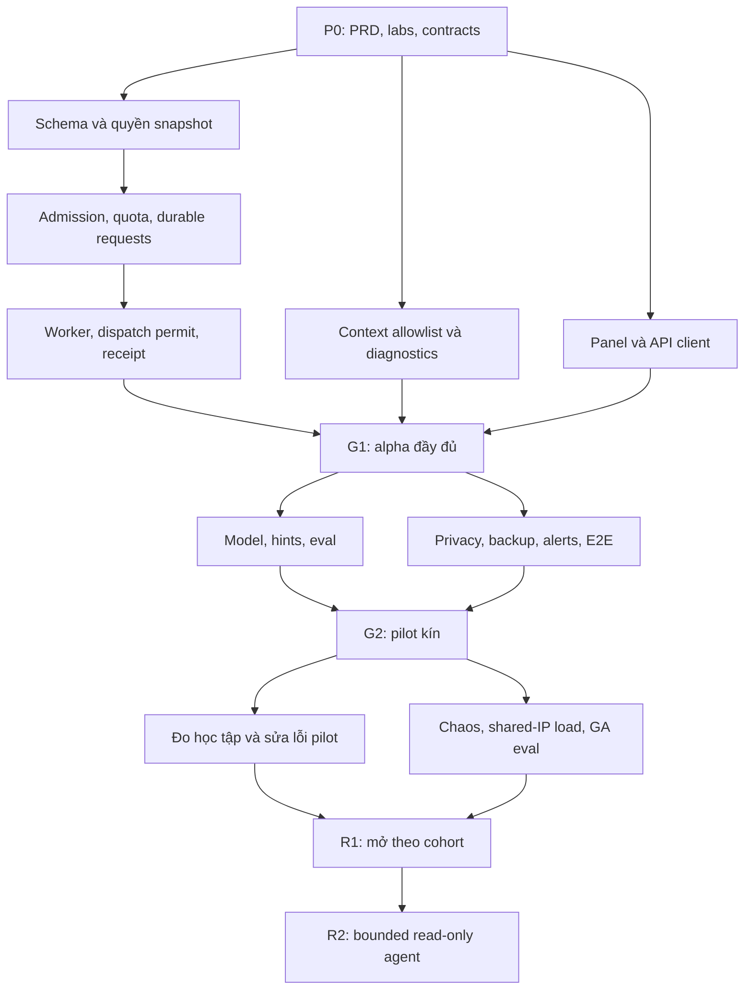

# 03 — Backlog và kế hoạch thực hiện cho một người

[Về kế hoạch tổng](README.md) · [PRD](01-product-and-learning.md) · [Kiến trúc](02-architecture-and-contracts.md) · [Release gates](04-quality-and-operations.md)

## 1. Cách đọc ước lượng

- Nguồn lực: một người có AI hỗ trợ. Một tuần giả định có **25 giờ tập trung**, bao gồm phân tích, code, review, kiểm thử và tài liệu. Thời gian đi làm khác/học tập phải trừ trước khi áp dụng lịch.
- Ước lượng là **giờ công**, không phải thời gian model chạy. AI có thể giảm thao tác lặp nhưng không được tính như thêm hai lập trình viên.
- Mỗi task đã gồm test cục bộ và cập nhật tài liệu của task; QA riêng là kiểm thử tích hợp, đối kháng và tình huống liên thành phần.
- Cộng **25% dự phòng** cho tích hợp, lỗi, học công nghệ và phát hiện trong pilot. Không áp dụng thêm hệ số “AI nhanh gấp X” khi chưa có dữ liệu thực tế.
- Task hơn 16 giờ nên chia thành PR nhỏ theo contract/migration/implementation/test; không đợi toàn phase mới tích hợp.
- Ước lượng chưa bao gồm nâng cấp hạ tầng lõi ngoài phạm vi AI, sửa hàng loạt nội dung khóa học, thanh toán hoặc RAG quy mô lớn. Nếu audit phát hiện chúng là điều kiện chặn, tạo task riêng và cập nhật lịch.

### 1.1. Tổng công việc

| Phase                   | Mục tiêu                                            | Số task |   Giờ thấp | Giờ cao |
| ----------------------- | --------------------------------------------------- | ------: | ---------: | ------: |
| P0                      | Chốt sản phẩm, lab, contract và điều kiện vận hành  |       5 |         29 |      48 |
| P1                      | Nền tảng đầy đủ và alpha nội bộ                     |      15 |        124 |     188 |
| P2                      | Model thật, trải nghiệm, tải shared IP và pilot kín |      11 |         98 |     152 |
| P3                      | Củng cố chất lượng và phát hành R1                  |       9 |         70 |     108 |
| **R1 tổng**             | **P0 + P1 + P2 + P3**                               |  **40** |    **321** | **496** |
| **R1 gồm 25% dự phòng** |                                                     |         | **401,25** | **620** |
| P4                      | R2 agent chỉ đọc, tính riêng                        |       7 |         58 |      92 |

### 1.2. Lịch suy ra từ giờ công

| Khả năng làm mỗi tuần | R1, gồm dự phòng      | Cách sử dụng                                        |
| --------------------- | --------------------- | --------------------------------------------------- |
| 15 giờ                | Khoảng 27–42 tuần     | Phù hợp làm thêm bên cạnh công việc chính           |
| **25 giờ**            | **Khoảng 17–25 tuần** | **Giả định cơ sở của kế hoạch**                     |
| 35 giờ                | Khoảng 12–18 tuần     | Chỉ dùng nếu thực tế duy trì được giờ tập trung này |

Tại 25 giờ/tuần, kịch bản trung tâm khoảng **21 tuần**. Đây là forecast để phân bổ nguồn lực, không phải cam kết ngày phát hành. Sau P0 và hai tuần triển khai đầu, cập nhật bằng throughput thực tế và công việc còn lại.

Alpha đầy đủ P0+P1: 153–236 giờ, khoảng 8–12 tuần có dự phòng. Bắt đầu pilot sau các task P2 trừ phần tổng kết REL-02: 239–368 giờ lũy kế, khoảng 12–19 tuần. Pilot quan sát tối thiểu 14 ngày; trong thời gian chờ D7 có thể làm các task P3 không phụ thuộc kết quả người học. Nếu hết việc độc lập, thêm thời gian chờ vào forecast, không bỏ cửa sổ quan sát.

R2 thêm 58–92 giờ, tương đương khoảng 3–5 tuần ở 25 giờ/tuần có dự phòng, cộng thời gian cohort quan sát cần thiết. Nếu sau R1 dành 5 giờ/tuần cho vận hành và chỉ còn 20 giờ phát triển, forecast R2 là khoảng 4–6 tuần. R3 được ước lượng sau khi có số liệu R1/R2.

## 2. Mốc và đường phụ thuộc chính



Sơ đồ thể hiện phụ thuộc kỹ thuật, không có nghĩa một người thực hiện mọi nhánh cùng lúc. Work in progress tối đa một task code chính và một task chờ phản hồi/quan sát. Critical path thực tế: contract → dữ liệu/quyền → admission/quota → dispatch/receipt → FE tích hợp → live eval → pilot → release gates.

### 2.1. Gợi ý nhịp 21 tuần cơ sở

| Tuần tham chiếu | Trọng tâm                                                                      | Demo/bằng chứng cuối giai đoạn                                  |
| --------------- | ------------------------------------------------------------------------------ | --------------------------------------------------------------- |
| 1–2             | P0; kiểm kê hạ tầng; chốt ba lab; skeleton contract                            | Chạy golden fixtures và mô phỏng luồng người học trên wireframe |
| 3–5             | Schema, auth snapshot, reservation, request lifecycle                          | 20 retry chỉ tạo một request; người khác bị chặn                |
| 6–8             | Worker/Python fake, diagnostics, panel/hook, CI                                | Browser reload vẫn lấy đúng kết quả; không giữ khóa lab lúc chờ |
| 9–10            | Hoàn tất alpha, prompts và provider adapter thật, eval lần 1                   | Báo cáo chất lượng/chi phí theo model configuration             |
| 11–15           | Privacy, feedback/events, E2E, tải shared IP, backup; mời pilot khi đạt G2     | Luồng thật trên staging, có kill switch và budget               |
| 16–17           | Quan sát pilot và sửa lỗi; làm test/ops độc lập                                | Báo cáo 14 ngày, chỉ rõ sample size và lỗi còn lại              |
| 18–19           | Fault tests, eval mở rộng, xác nhận lại capacity sau sửa lỗi, rollback/restore | Bộ release evidence đạt ngưỡng R1                               |
| 20–21           | Canary, mở cohort dần, hỗ trợ, tổng kết                                        | Quyết định mở rộng/giữ cohort; backlog R2 cập nhật              |

Tuần tham chiếu có thể dịch trong dải 17–25 tuần. Không đặt ngày cụ thể khi chưa biết giờ làm và thời điểm bắt đầu. Nếu AI hỗ trợ giúp hoàn thành sớm, dùng số liệu task thực tế để forecast lại thay vì hứa giảm toàn bộ lịch ngay từ đầu.

## 3. P0 — Chuẩn bị và chốt thiết kế

### DISC-01 · Kiểm kê nền tảng · 4–6 giờ

- **Trạng thái 19/10/2026:** [x] Hoàn thành kiểm kê. [Baseline và bằng chứng](baseline/DISC-01-platform-baseline.md) · [ADR-000](adr/ADR-000-platform-baseline.md) · [7 issue cần theo dõi](baseline/DISC-01-blockers.md). Các phần chưa xác minh được ghi rõ và có gate xử lý; chưa xác nhận stack đủ điều kiện pilot. DISC-02 được bỏ qua theo yêu cầu; task tiếp theo: DISC-03.
- **Vai trò:** SO/SE. **Phụ thuộc:** không. **Đầu ra:** baseline matrix local/main/staging/production, commit đang chạy, migration status, topology proxy và secrets inventory chỉ tên key.
- **Phạm vi/file:** README kế hoạch, ADR nền tảng, `.github/workflows/ci-cd.yml`, `compose*.yaml`, `docs/operations.md` để đối chiếu; không tự triển khai production trong task kiểm kê.
- **Nghiệm thu:** phân biệt rõ thay đổi local chưa deploy; lập issue cho blocker auth/migration/backup/proxy. Không dùng “CI main từng xanh” làm bằng chứng stack hiện tại đã sẵn sàng.

### DISC-02 · Khám phá người học và xác nhận PRD · 5–8 giờ

- **Trạng thái 19/10/2026:** **BỎ QUA theo yêu cầu người dùng**. Chưa thực hiện 3–5 quan sát/phỏng vấn, chưa có baseline học tập hoặc kết luận về ba vướng mắc thực tế. PRD hiện có tiếp tục là giả thuyết thiết kế, chưa được xác nhận bằng nghiên cứu người học; không tính DISC-02 là hoàn thành nghiệm thu.
- **Vai trò:** PM. **Phụ thuộc:** DISC-01. **Đầu ra:** 3–5 cuộc quan sát/phỏng vấn ngắn, top ba vướng mắc, baseline và lịch pilot.
- **Phạm vi/file:** tài liệu 01 và `research/` khi triển khai; nguồn tuyển người học và thông báo dữ liệu.
- **Nghiệm thu:** xác định người học mục tiêu, hành trình ưu tiên, metric và AC-01…AC-16; giả thuyết chưa có dữ liệu phải được ghi rõ, không viết như sự thật.

### DISC-03 · Chứng nhận ba lab và fixtures đầu tiên · 10–16 giờ

- **Trạng thái 19/10/2026:** [x] Hoàn thành chứng nhận kỹ thuật local cho `AI-IPV4-01`, `AI-ROUTE-01`, `AI-VLAN-01`: mỗi lab hai cấu hình đúng, sáu lỗi và lời giải/repair chạy qua engine thật. [Hồ sơ và bằng chứng](labs/DISC-03-certified-labs.md) · [Issue nguồn/capability](labs/DISC-03-source-issues.md). Bộ chứng nhận 31/31 đạt; chưa publish hoặc có review CCNA độc lập. Task tiếp theo: ADR-01.
- **Điều chỉnh phụ thuộc 19/10/2026:** người dùng đã yêu cầu bỏ qua DISC-02; có thể chuẩn bị/chứng nhận lab dựa trên PRD hiện có như giả định thiết kế. Việc chứng nhận kỹ thuật không thay thế bằng chứng nghiên cứu người học hoặc nghiệm thu pilot.
- **Vai trò:** PM/SE; reviewer CCNA nếu có. **Phụ thuộc:** DISC-02. **Đầu ra:** ba lab IPv4/interface, route và VLAN; mỗi lab có golden solution, tối thiểu năm lỗi và hai cấu hình đúng.
- **Phạm vi/file:** fixtures mới trong `src/agent/python/evals/` và Node test fixtures; đối chiếu `networkEngine`, `gradingEngine`, command catalog. Nội dung cần sửa được ghi issue riêng.
- **Nghiệm thu:** golden actions chạy đúng simulator/grader; có case cổng unused shutdown và default route hợp lệ; giữ private rubric ngoài provider fixtures. AC-01/03/09.

### ADR-01 · Chốt contract và các invariant · 6–10 giờ

- **Trạng thái 19/10/2026:** [x] Hoàn thành thiết kế ADR-001…007 và [contract v1.0.0](../../src/agent/contracts/ai-lab/v1/README.md): 17 JSON Schema, fixtures chung frontend/Node/Python, state machine, error map và [threat review](../../src/agent/contracts/ai-lab/v1/threat-scenarios.md). Async/ownership đã chốt; transaction/quota race/auth runtime vẫn thuộc BE/QA tiếp theo. Chưa có endpoint AI hay provider có phí. Task tiếp theo: OPS-00.
- **Vai trò:** SO/SE. **Phụ thuộc:** DISC-01, DISC-03. **Đầu ra:** ADR-001…007, schema public/internal, state machine và threat scenarios.
- **Phạm vi/file:** `src/agent/contracts/ai-lab/v1/`, tài liệu 02, fixtures valid/invalid; chọn envelope lỗi thống nhất.
- **Nghiệm thu:** rà trường hợp retry, quota race, dispatch unknown, revoke, delete, stale; FE/Node/Python dùng cùng schema. Không còn quyết định mâu thuẫn về sync/async hoặc ownership.

### OPS-00 · Chốt ngân sách và khả năng triển khai · 4–8 giờ

- **Trạng thái 22/10/2026:** [x] Hoàn thành **nhánh local/fake, 0 USD theo lựa chọn người dùng**. [ADR-008](adr/ADR-008-local-fake-deployment.md) · [Budget, môi trường và bằng chứng](ops/OPS-00-local-fake.md) · [Worksheet](ops/OPS-00-budget.json). Cluster PostgreSQL riêng đã kiểm identity/restart/ghi/rollback/SCRAM; chưa có migration ứng dụng. Task tiếp theo: BE-01 trên DB thử riêng.
- **Điều chỉnh phạm vi:** dùng fake cho P1, không gọi provider kể cả free tier. Người dùng có Gemini nhưng RPM/TPM/RPD còn chưa xác minh; chưa thuê host/staging cloud. Các điều kiện gọi model thật và G0 đầy đủ dưới đây vẫn mở, không tính nhánh local là nghiệm thu pilot.
- **Yêu cầu sau đó 22/10/2026:** [ADR-009](adr/ADR-009-local-live-gemini.md) cho phép Gemini thật trên nút giải thích kết quả local với budget có thực thi; smoke thật đã đạt. Đây là ngoại lệ local, không đánh dấu các BE/PY/AI/OPS hoặc G0/G1/G2 đầy đủ hoàn thành; giới hạn tài khoản vẫn chưa xác minh.
- **Vai trò:** SO/PM. **Phụ thuộc:** DISC-01, ADR-01. **Đầu ra:** host/region, provider shortlist, budget pilot/ngày/tháng, giờ hỗ trợ và người nhận cảnh báo.
- **Phạm vi/file:** ADR deployment và worksheet ngân sách; lưu tên secrets, không ghi giá trị vào Git.
- **Nghiệm thu:** có cap hữu hạn trước gọi model thật; biết limit RPM/TPM của tài khoản sẽ dùng; chọn được staging tách dữ liệu/key production. G0 hoàn thành.

## 4. P1 — Nền tảng và alpha đầy đủ

### BE-01 · Schema, migrations và indices · 8–12 giờ

- **Trạng thái 23/10/2026:** [x] Hoàn thành local: 11 model R1, migration bổ sung và metadata nullable, 34/34 kiểm DB mới/nâng cấp; 25 bảng domain cũ giữ nguyên dữ liệu, schema diff rỗng và client cũ đọc/ghi được. Có gate CI và kiểm backup/restore local. [Hồ sơ nghiệm thu](baseline/BE-01-storage.md). Chưa áp migration DB ứng dụng/production; endpoint và quota/worker runtime ở các task tiếp theo. **Tiếp theo: BE-02.**
- **Vai trò:** SE. **Phụ thuộc:** ADR-01. **File:** `src/backend/prisma/schema.prisma`, migration mới, Node integration fixtures.
- **Thực hiện:** conversation/request/message/provider call/quota/reservation/adjustment/execution slots/runtime policy/feedback/outbox; indexes và partial unique active request; migration metadata lab nullable.
- **Nghiệm thu:** DB mới migrate deploy được; upgrade DB có dữ liệu giữ nguyên rows; constraints chặn duplicate; verify schema diff; rollback code cũ vẫn chạy. AC-05/06/12.

### BE-02 · Quyền và snapshot attempt · 8–12 giờ

- **Trạng thái 23/10/2026:** [x] Hoàn thành nền local: guard AI đã mount, metadata/feedback tích hợp start/submit, snapshot/provenance và kiểm quyền trên DB/HTTP thật. 7 integration + 6 unit tests đạt. [Bằng chứng và giới hạn kết nối](baseline/BE-02-access-snapshot.md). Tiếp theo BE-03; chưa có admission API hoặc browser E2E.
- **Vai trò:** SE. **Phụ thuộc:** BE-01, DISC-03. **File:** `src/agent/node/access.js`, `snapshot.js`, integration với `attemptAccess.js` và controller.
- **Thực hiện:** Bearer header riêng cho AI, active user/sessionVersion, membership, cohort, conversation owner/epoch; chụp metadata/state/progress an toàn và provenance cho legacy; xử lý tương thích envelope lỗi auth hiện có.
- **Nghiệm thu:** outsider/removed member bị 404; account locked bị 401; owner lab không đọc chat member; snapshot không đổi khi lab/state thay đổi; transaction ngắn. AC-04/06.

### BE-03 · Admission, idempotency và quota transaction · 12–18 giờ

- **Trạng thái 23/10/2026:** [x] Hoàn thành admission local: POST/GET request, capabilities/quota, canonical replay, recovery epoch và atomic reservation/outbox. 20 request cùng ID qua hai Node process chỉ tạo một request; quota race/fault rollback đạt. [Bằng chứng và cấu hình](baseline/BE-03-admission.md). Worker/settlement tiếp tục BE-04; chưa bật production hoặc UI hội thoại.
- **Vai trò:** SE/SO. **Phụ thuộc:** BE-01, BE-02, OPS-00. **File:** `ai/requests.js`, `quota.js`, `reservations.js`, `routes/aiLab.js`, controller.
- **Thực hiện:** canonical payload hash; replay trước stale check; recovery epoch khi mất ledger sau restore; reserve units/cost; global/user buckets; one active request/user; error schema.
- **Nghiệm thu:** 20 requests cùng ID qua hai replica tạo một request; key khác vượt quota bị từ chối; khác payload cùng key trả 409; không âm bucket; DB quota lỗi không gọi provider. AC-05/07/14.

### BE-04 · Worker, dispatch permit và receipt · 12–18 giờ

- **Trạng thái 23/10/2026:** [x] Hoàn thành worker local/fake: claim/heartbeat/fence/reaper, shared slots, service auth, permit một lần, receipt/settlement/reconcile và cancel. Hai process cùng PostgreSQL kiểm crash/race/rollback; CLI hoạt động khi fake ngủ. [Bằng chứng và giới hạn](baseline/BE-04-worker.md). Chưa bật provider thật hoặc migrate DB ứng dụng; tiếp theo BE-05.
- **Vai trò:** SE. **Phụ thuộc:** BE-03. **File:** `workers/aiWorker.js`, `ai/dispatch.js`, `receipts.js`, `leases.js`, `routes/aiInternal.js`.
- **Thực hiện:** queue claim, heartbeat/fence, reaper, grant/cancel permit, receipt idempotent, reconcile known/unknown; provider call outside transaction.
- **Nghiệm thu:** worker chết trước dispatch được phục hồi an toàn; chết sau permit không gọi lại model; late worker không overwrite; receipt duplicate settle một lần; CLI không chờ lock trong thời gian model fake ngủ. AC-05/08/14.

### BE-05 · Context allowlist và output verifier · 10–14 giờ

- **Trạng thái 26/10/2026:** [x] Hoàn thành local/fake: lọc snapshot, che dữ liệu nhạy cảm, lịch sử đúng chủ/attempt/epoch, giới hạn bytes/ngân sách input, evidence quan sát và lệnh đọc kiểm qua parser. Kiểm output trước giữ text, giữ accounting khi loại câu trả lời. 121 unit/contract, 34 storage và 35 DB/HTTP đạt. [Báo cáo dễ hiểu và giới hạn](baseline/BE-05-context-output.md). Chưa có tokenizer/provider thật, lịch sử CLI đầy đủ hoặc quy tắc nguyên nhân SIM-01; tiếp theo SIM-01 và PY-01/PY-02.
- **Vai trò:** SE/SO. **Phụ thuộc:** BE-02, ADR-01. **File:** `ai/context.js`, `redaction.js`, `evidence.js`, contract fixtures.
- **Thực hiện:** public projection, token/byte cap, history cùng owner/epoch, evidence provenance, output schema và command catalog validation.
- **Nghiệm thu:** canary secrets/rubric/actor ID không xuất hiện ở Python/provider boundary; unknown evidence/command bị chặn; nội dung câu hỏi/CLI không thể thêm tool hoặc quyền. AC-01/02/06.

### SIM-01 · Diagnostics của ba lab R1 · 12–18 giờ

- **Trạng thái 26/10/2026:** [x] Hoàn thành kỹ thuật local/fake với catalog `sim01-r1-v1`, quy tắc cổng/link/IP/subnet/route/VLAN và probe clone qua simulator thật. 24 ca DISC-03 cùng ca sửa lỗi/âm tính/mơ hồ đạt; SIM-01 36/36, tổng unit/contract 158/158, storage 34/34, HTTP/DB 36/36. Verifier chỉ nhận kết luận chẩn đoán mạnh đúng mẫu/phạm vi/bằng chứng Node. [Báo cáo và giới hạn](baseline/SIM-01-diagnostics.md). Chưa review CCNA độc lập, model/browser/load; tiếp theo PY-01/PY-02.
- **Vai trò:** SE + reviewer domain. **Phụ thuộc:** DISC-03, BE-05. **File:** `ai/diagnostics/`, simulator test fixtures; tái sử dụng network engine.
- **Thực hiện:** rule interface, subnet, route, VLAN; clone-only trace, rules có version; trạng thái observed/inferred/unsupported.
- **Nghiệm thu:** đúng positive/negative/ambiguous fixtures; unused port không thành root cause; default route được xét; trước/sau phân tích state/hash và score giống nhau. AC-01/09.

### PY-01 · Python service, môi trường tái lập và health · 5–8 giờ

- **Trạng thái 26/10/2026:** [x] Hoàn thành local/fake: Python 3.11/FastAPI, uv.lock, strict config, JWT tương thích Node, body/stream/deadline/capacity limits và health. Fake chỉ ACK sau claim/receipt ở Node; không bật worker transport hoặc model thật. 149 test Python, clean install và 270 hồi quy Node đạt. [Báo cáo dễ hiểu](baseline/PY-01-service.md). Chưa chạy image Docker/CI mới; tiếp theo PY-02.
- **Vai trò:** SE. **Phụ thuộc:** ADR-01. **File:** `src/agent/python/pyproject.toml`, lockfile, `app/main.py`, config/security, Dockerfile.
- **Thực hiện:** chọn runtime Python và dependency versions đã kiểm; strict config; service auth; input/body limits; liveness/readiness; fake adapter.
- **Nghiệm thu:** clean install từ lockfile; không key thì readiness AI báo degraded/disabled đúng; không log secret; test internal auth/size/deadline; không public port ngoài yêu cầu vận hành.

### PY-02 · Provider adapter và output contract · 8–12 giờ

- **Trạng thái 26/10/2026:** [x] Hoàn thành kỹ thuật local: worker transport Python, fake/Gemini, preflight toàn prompt/schema trước claim, Pydantic parity, usage nullable và receipt-only retry. Ngân sách dùng chung ledger với luồng local cũ. Một lượt Gemini thật hoàn tất qua worker/Python/PostgreSQL; 250 Python, 274 hồi quy Node, 34 storage và 42 HTTP/DB đạt. [Báo cáo dễ hiểu](baseline/PY-02-provider.md), [phạm vi live local](adr/ADR-010-python-local-gemini.md). Chưa nghiệm thu chất lượng model, UI hội thoại hoặc pilot.
- **Vai trò:** SE. **Phụ thuộc:** PY-01, BE-04, BE-05. **File:** `app/adapters/`, `schemas/`, receipt client và tests.
- **Thực hiện:** interface provider-neutral, fake provider, claim permit trước call, retry=0, deadlines, usage nullable, receipt retry riêng; model config server-side.
- **Nghiệm thu:** valid/invalid fixtures qua cả Zod/Pydantic; timeout/429/malformed/usage missing có mapping rõ; hai lần cùng permit không dispatch hai call; không nhận endpoint URL từ user. AC-07/14.

### UX-01 · Wireframe và copy trạng thái · 5–8 giờ

- **Vai trò:** PM/SE. **Phụ thuộc:** DISC-02, ADR-01. **File:** design notes + UI mock trong môi trường local khi triển khai.
- **Thực hiện:** desktop/mobile, empty/pending/stale/offline/quota/fallback, hint policy, thông báo dữ liệu, feedback.
- **Nghiệm thu:** walkthrough năm tình huống: lần đầu, lỗi mạng, lab nhóm, đổi account, provider down; người đọc hiểu khi nào câu trả lời dựa trên cấu hình cũ. AC-04/07/13.

### FE-01 · Panel và components · 8–12 giờ

- **Vai trò:** SE. **Phụ thuộc:** UX-01. **File:** `src/frontend/src/features/ai-lab/`, CSS theo lab tokens.
- **Thực hiện:** panel lazy-load, message/evidence, hint card, code copy, feedback; semantic HTML, focus handling.
- **Nghiệm thu:** render bằng fake responses; Markdown không chạy HTML/script; bật panel không phá terminal sizing; loading riêng; không auto-scroll khi đọc lịch sử. AC-08/13.

### FE-02 · Hook, API và phục hồi request · 10–16 giờ

- **Vai trò:** SE. **Phụ thuộc:** FE-01, BE-03, PY-02. **File:** `useAiLabAssistant.js`, `Api.js`, `CliLabWorkspace.js`, component tests.
- **Thực hiện:** stable clientRequestId, 202/poll/backoff, by-client-id recovery, cache scope user/auth/attempt/epoch, cancel và history cursor.
- **Nghiệm thu:** reload nhận lại kết quả; retry cùng ID; response user A tới muộn không hiện cho B; đóng panel dừng poll; terminal dùng độc lập. AC-04/05/06/08.

### BE-06 · Khép đường provider cũ và fallback chung · 4–6 giờ

- **Vai trò:** SE. **Phụ thuộc:** BE-03, BE-05. **File:** `labFeedback.js`, `labAttemptController.js`, cấu hình legacy.
- **Thực hiện:** `/explain` tạm dùng deterministic response tương thích khi chuyển AI; fallback templates theo public facts; cùng policy nội dung.
- **Nghiệm thu:** không còn endpoint cũ gọi có phí bỏ qua quota; existing UI vẫn đọc explanation được; fallback không chứa hidden fields hoặc nhãn giả model. AC-07/11/14.

### QA-01 · Test quyền, dữ liệu và concurrency nền tảng · 10–16 giờ

- **Vai trò:** SE/SO. **Phụ thuộc:** BE-04, BE-05, SIM-01, PY-02, FE-02, BE-06. **File:** Node/Python integration suites.
- **Thực hiện:** hai replica, double-submit, quota race, removed member, session revoked, snapshot change, no-mutation, output corruption.
- **Nghiệm thu:** nhóm T-AUTH/T-IDEM/T-STATE/T-COST nền tảng trong tài liệu 04 pass trên PostgreSQL thật; counter fake-provider chứng minh số call. Không chỉ assert số message DB.

### OPS-01 · CI và stack container alpha · 8–12 giờ

- **Vai trò:** SE/SO. **Phụ thuộc:** BE-04, PY-01, QA-01. **File:** CI workflow, compose AI additions, worker command, environment example.
- **Thực hiện:** tests Node/Python/contracts, image build, startup dependencies, private service networking, giới hạn CPU/RAM/DB pool, migration job một lần.
- **Nghiệm thu:** dựng clean stack staging/local; restart worker/Python không mất request; src/frontend/Node build hiện tại vẫn pass; runtime không chứa provider key trong bundle/image layer.

### GATE-01 · Demo alpha và rà thiết kế · 4–6 giờ

- **Vai trò:** PM/SO/SE. **Phụ thuộc:** OPS-01, FE-02, SIM-01. **Đầu ra:** báo cáo G1 và clip/ghi chép demo nội bộ nếu cần.
- **Thực hiện:** học viên giả lập mở lab, gửi câu hỏi, chạy terminal trong lúc chờ, reload, xem kết quả, đổi tài khoản, revoke member.
- **Nghiệm thu:** một luồng đầy đủ không phụ thuộc model thật; không còn blocker quyền/chi phí/locking; cập nhật effort và scope sau trải nghiệm thực.

## 5. P2 — Chất lượng model và pilot kín

### AI-01 · Prompt, hints và kiến thức lab · 8–12 giờ

- **Vai trò:** PM/SE. **Phụ thuộc:** GATE-01, DISC-03. **File:** prompts versioned, hint-policy fixtures, content manifest.
- **Thực hiện:** tiếng Việt/thuật ngữ CLI; ba cấp gợi ý; phân biệt fact/hypothesis; cách hỏi thêm; no-solution policy; concept snippets được duyệt.
- **Nghiệm thu:** câu trả lời ngắn, có bước kiểm chứng; public values dùng được, hidden values không nhận từ context; có case cố xin full config; reviewer đọc mẫu. AC-01/02/03.

### AI-02 · Chọn model bằng eval và cost measurement · 12–18 giờ

- **Vai trò:** SO/SE/PM. **Phụ thuộc:** AI-01, PY-02, OPS-00. **File:** eval runner, dataset manifest, report model comparison.
- **Thực hiện:** tối thiểu 60 scenario domain cho pilot, bộ security/fault riêng; ít nhất hai cấu hình model; ghi token, usage unknown, latency, rubric scores và version.
- **Nghiệm thu:** gate pilot đạt; chọn model vì quality/cost/latency/data policy có bằng chứng; bảng giá và cap đã nhập; không sửa holdout để làm đẹp điểm.

### FE-03 · Hoàn thiện UX lỗi, stale và hints · 8–12 giờ

- **Vai trò:** SE/PM. **Phụ thuộc:** FE-02, AI-01. **File:** panel/hook/workspace và tests.
- **Thực hiện:** quick actions nguồn/đích, hint escalation, stale updates theo revision live, lỗi proxy không JSON, network loss, preview/replay, outcome unknown.
- **Nghiệm thu:** không tự retry tạo phí mới; user hiểu quota/fallback; stale không biến mất sau poll; không khóa thao tác CLI. AC-01/02/04/07/08.

### BE-07 · Feedback, analytics outbox và dashboard đầu tiên · 8–12 giờ

- **Vai trò:** SE/PM. **Phụ thuộc:** BE-01, GATE-01. **File:** feedback endpoint, outbox exporter, metrics queries/dashboard.
- **Thực hiện:** feedback owner-only, reason codes, events dedup; funnel panel → accepted → viewed → check transition; pseudonymous metrics.
- **Nghiệm thu:** transaction lỗi không tạo event thành công; exporter retry không đếm đôi; analytics không chứa prompt/CLI output; báo sample size và dữ liệu thiếu. AC-10.

### BE-08 · Xóa hội thoại, retention và chống output hồi sinh · 10–16 giờ

- **Vai trò:** SE/SO. **Phụ thuộc:** BE-04, FE-02. **File:** deletion/tombstone service, retention job, UI settings, privacy copy.
- **Thực hiện:** epoch increment, queued cancellation, in-flight suppression, purge snapshot/chat, accounting pseudonymization, access logs tối thiểu.
- **Nghiệm thu:** delete giữa provider call và completion không tạo lại chat; restore áp lại deletion ledger; account deletion không mất unresolved accounting; thời hạn purge có metric. AC-06/12.

### OPS-02 · Budget, kill switch và observability · 8–12 giờ

- **Vai trò:** SO/SE. **Phụ thuộc:** BE-04, BE-07, AI-02. **File:** runtime flags, metrics/logging, alerts/config dashboard.
- **Thực hiện:** request correlation, call/usage states, cost theo model/cohort, cap theo ngày/tháng; kill switch server và dispatch; cảnh báo secrets redacted.
- **Nghiệm thu:** chạm cap không phát thêm permit; flag off khi queued/running có kết quả đúng; người vận hành truy lỗi bằng request ID mà không mở raw prompt. AC-14.

### QA-02 · E2E pilot trên browser thật · 8–12 giờ

- **Vai trò:** SE/PM. **Phụ thuộc:** FE-03, BE-07, BE-08, OPS-02. **File:** Playwright E2E và test fixtures mới khi triển khai.
- **Thực hiện:** đăng ký/login → mở khóa học/lab → AI → tự sửa → submit → review → reload → logout/account switch; group/revoke và offline.
- **Nghiệm thu:** chạy với src/backend/PostgreSQL và fake Python/provider thật qua HTTP; network fixtures không thay toàn backend; test dữ liệu user A không hiện cho B. AC-01…AC-12 trọng yếu.

### OPS-04 · Load test, shared IP và capacity policy · 12–18 giờ

- **Vai trò:** SO/SE. **Phụ thuộc:** QA-02, OPS-01, OPS-02. **File:** load scripts, Nginx/rate-limit policy đề xuất, capacity report.
- **Thực hiện:** 20/50/100 learners với src/shared/different IP; hai src/backend/worker; CLI + poll + AI; đo edge429/app429, queue, DB locks, provider concurrency. Chạy trước pilot để lỗi NAT không chặn học viên thật; xác nhận lại phần bị ảnh hưởng trước R1 nếu code/hạ tầng đổi.
- **Nghiệm thu:** tải công bố đạt SLO; cùng user qua replica không nhân quota; proxy không gom lớp như một người. Thay policy edge là thay đổi bảo vệ có review/benchmark, không chỉ xóa giới hạn. AC-15.

### OPS-03 · Staging, backup và rehearsals trước pilot · 6–10 giờ

- **Vai trò:** SO/SE. **Phụ thuộc:** OPS-01, BE-08, OPS-02, OPS-04. **File:** deployment runbook, backup manifest, config environments.
- **Thực hiện:** staging DB/key riêng, backup off-host có mã hóa, restore cả chat/accounting; disable AI → rollback image → smoke lab; thử lớp pilot chung IP.
- **Nghiệm thu:** restore vào DB cách ly, không replay paid jobs; không cần tắt lab để xử lý provider down; nếu shared IP còn bị chặn thì giải quyết policy trước mời lớp, không bỏ qua gate.

### REL-01 · Chuẩn bị và mở pilot kín · 6–10 giờ

- **Vai trò:** PM/SO. **Phụ thuộc:** AI-02, QA-02, OPS-03. **File:** pilot roster có quyền riêng, onboarding, gate report, feedback form.
- **Thực hiện:** mời 10–20 học viên, công bố giới hạn/giờ hỗ trợ, cap ngân sách, chọn cohort server-side, dashboard baseline.
- **Nghiệm thu:** G2 pass; người dùng ngoài cohort không dispatch; rollback/kill switch được diễn tập; mọi lab pilot có manifest nội dung. Không đưa danh tính học viên vào Git.

### REL-02 · Quan sát, phân tích và sửa lỗi pilot · 12–20 giờ

- **Vai trò:** PM/SO/SE. **Phụ thuộc:** REL-01. **Đầu ra:** báo cáo ít nhất 14 ngày và danh sách lỗi phân loại.
- **Thực hiện:** đọc mẫu đáp án, thống kê cost/recovery/feedback/D7; tối thiểu 100 lượt hoàn thành nếu lượng dùng cho phép; thêm regression fixtures cho lỗi thật đã khử định danh.
- **Nghiệm thu:** ghi số mẫu và hạn chế; blocker dữ liệu/quota/diagnosis được sửa; quyết định giữ, đổi hay mở rộng scope dựa trên dữ liệu. Công sửa vượt dải dự phòng phải reforecast.

## 6. P3 — Chất lượng public và R1

### SIM-02 · Củng cố nội dung theo pilot · 8–12 giờ

- **Vai trò:** PM/SE. **Phụ thuộc:** REL-02. **File:** diagnostics/content fixtures và lab manifests.
- **Thực hiện:** sửa lỗi ba lab R1, bổ sung biến thể topology/case đúng; chỉ mở thêm protocol nếu không làm trượt gate và có task riêng.
- **Nghiệm thu:** golden solution và negative cases pass; thay lab/rule có version; dữ liệu feedback thật được anonymize; AC-01/03/09 cải thiện ở nhóm lỗi đã ghi.

### BE-09 · Giải thích kết quả đúng revision · 8–12 giờ

- **Vai trò:** SE. **Phụ thuộc:** BE-06, BE-08, AI-01. **File:** submit feedback metadata, `LAB_REVIEW`, UI result actions.
- **Thực hiện:** lưu feedbackRevision/recordedAt atomic với grading; safe feedback context; legacy fallback; UI migrate khỏi `/explain` có phí.
- **Nghiệm thu:** feedback chưa đạt nhưng attempt IN_PROGRESS được xử lý đúng; sửa lab/state sau submit không thay lời giải thích lịch sử; legacy không bị gán revision giả. AC-11.

### QA-03 · Eval R1 và review độc lập · 10–16 giờ

- **Vai trò:** SE/PM + reviewer CCNA nếu có. **Phụ thuộc:** AI-02, SIM-02, BE-09. **File:** tối thiểu 120 domain scenarios, reports và holdout manifest.
- **Thực hiện:** phân tầng theo lỗi/correct/ambiguous; chạy holdout ba lần; human rubric, regressions, so sánh model/prompt đang định deploy.
- **Nghiệm thu:** đạt ngưỡng tài liệu 04 trên từng nhóm, không chỉ trung bình; zero critical observed trong test bắt buộc; ghi giới hạn nếu chưa có reviewer ngoài.

### QA-04 · Fault injection và race-condition suite · 12–18 giờ

- **Vai trò:** SE/SO. **Phụ thuộc:** QA-01, BE-08, BE-09, OPS-02. **File:** fake provider controls, integration/chaos tests.
- **Thực hiện:** kill ở mỗi bước lifecycle, receipt trùng/mất/late, clock skew, midnight quota, DB deadlock/retry, stale fences, delete/revoke giữa tool/dispatch.
- **Nghiệm thu:** 30 fault scenarios tối thiểu; không gọi model trùng do retry mù, không double-settle, không output hồi sinh; tự phục hồi hoặc trạng thái unknown rõ ràng, có runbook.

### OPS-05 · Deployment container, alerts và release automation · 8–12 giờ

- **Vai trò:** SO/SE. **Phụ thuộc:** OPS-04, OPS-02. **File:** workflows, image registry integration, environment config/runbooks.
- **Thực hiện:** build immutable images, migration job, canary flags, drain workers, compatibility current/previous contract, readiness từng service, alert routing.
- **Nghiệm thu:** staging và production tách DB/key/budget; không chỉ deploy frontend Vercel rồi coi xong backend; rollback dùng image digest và flag, không rollback DB phá dữ liệu.

### OPS-06 · Khôi phục, retention và accounting reconciliation · 8–12 giờ

- **Vai trò:** SO/SE. **Phụ thuộc:** OPS-03, BE-08, QA-04. **File:** restore checklist, reconciliation/export, retention scheduled jobs.
- **Thực hiện:** restore mất máy, apply deletion tombstones, chặn dispatch sau restore, đối soát provider charges chưa có trong backup; đo RPO/RTO.
- **Nghiệm thu:** có evidence restore + checksum dữ liệu mẫu; unresolved không thành 0 cost; không gọi lại job cũ đã bị provider tính tiền; đạt mục tiêu RPO/RTO đã công bố.

### FE-04 · Accessibility, responsive và performance · 6–10 giờ

- **Vai trò:** SE/PM. **Phụ thuộc:** FE-03, BE-09. **File:** UI styles/components/tests.
- **Thực hiện:** keyboard/focus, reader announcements, 200% zoom, mobile orientation, terminal resize, lazy chunk/bundle delta.
- **Nghiệm thu:** AC-13 pass trên viewport đã định; không chèn key/provider config vào build; panel mở/đóng không mất terminal state; không poll khi hidden.

### DOC-01 · Tài liệu hỗ trợ và vận hành một người · 4–6 giờ

- **Vai trò:** PM/SO. **Phụ thuộc:** REL-02, OPS-05, OPS-06. **File:** learner help, support triage, operational handover notes.
- **Thực hiện:** FAQ quota/stale/privacy, giờ hỗ trợ, mức sự cố, cách tra request ID, lịch bảo trì, checklist tuần.
- **Nghiệm thu:** tự diễn tập ba ticket mà không đọc toàn code; tài liệu không công bố thông tin hạ tầng/secret cho người học; có người nhận alerts thực tế.

### REL-03 · Gate R1, canary và mở cohort · 6–10 giờ

- **Vai trò:** PM/SO/SE. **Phụ thuộc:** QA-03, QA-04, OPS-05, OPS-06, FE-04, DOC-01. **Đầu ra:** release evidence pack và quyết định rollout.
- **Thực hiện:** chọn immutable version; 5% → 25% → 50% → 100% eligible cohort theo quan sát; với ít user dùng số lượng cụ thể, không phần trăm gây hiểu nhầm.
- **Nghiệm thu:** tất cả gate cứng pass; chất lượng/chi phí/latency không vượt stop thresholds; cohort mới có support; lỗi critical rollback ngay. Mở 100% chỉ trong các lab/capacity được chứng nhận.

## 7. P4 — R2 agent chẩn đoán chỉ đọc

### R2-01 · PRD và phép so sánh agent · 4–6 giờ

- **Phụ thuộc:** REL-03. **Đầu ra:** ca R1 chưa giải quyết tốt, baseline cost/quality, ADR framework.
- **Nghiệm thu:** có tiêu chí lợi ích đủ để thêm orchestration; nếu không có, hoãn R2 và ưu tiên nội dung R1.

### R2-02 · Tool gateway trên snapshot · 10–16 giờ

- **Phụ thuộc:** R2-01. **File:** `ai/tools/`, contract tool fixtures, migration `AiToolCall`.
- **Nghiệm thu:** topology/interfaces/routes/VLAN/ping/public progress scope đúng, clone-only, evidence version; unsupported trả trạng thái rõ. AC-16.

### R2-03 · Capability và quyền mỗi tool · 8–12 giờ

- **Phụ thuộc:** R2-02. **File:** internal auth/capability validator, security tests.
- **Nghiệm thu:** token hết hạn, tool ngoài allowlist, khác attempt, revoke/sessionVersion/delete đều bị chặn; không có arbitrary command/URL.

### R2-04 · Bounded orchestration và persistence · 12–20 giờ

- **Phụ thuộc:** R2-03. **File:** Python orchestrator, adapter Node tools, checkpoint policy.
- **Nghiệm thu:** chọn framework qua spike; max 3 model calls/5 tools/45 giây; loop dừng đúng; checkpoint không đọc business DB; resume không gọi lại paid step chưa rõ outcome.

### R2-05 · Accounting từng bước và UI trạng thái · 8–12 giờ

- **Phụ thuộc:** R2-04. **File:** provider-call ledger extension, tool logs, UI progress summary.
- **Nghiệm thu:** reserve tổng budget trước start; mỗi bước có permit; receipt/retry không double bill nội bộ; UI chỉ hiển thị tóm tắt hành động/bằng chứng, không chain-of-thought.

### R2-06 · Agent eval và adversarial tests · 10–16 giờ

- **Phụ thuộc:** R2-05. **File:** tool trajectories, attack fixtures, comparative report.
- **Nghiệm thu:** tool schema đúng, zero state mutation, xử lý tool failure/loop/budget; so quality/cost với R1 trên cùng input và holdout. Không tăng quyền để làm đẹp tỷ lệ giải được.

### R2-07 · Canary và quyết định mở rộng · 6–10 giờ

- **Phụ thuộc:** R2-06. **Đầu ra:** cohort report, runbook R2, release decision.
- **Nghiệm thu:** có cải thiện giá trị trên nhóm ca mục tiêu, không vượt cost/latency cap, có rollback về R1 theo intent; AC-16 đạt. Cửa sổ quan sát lịch thực tính riêng khi cần.

## 8. Definition of Ready / Done cho mọi issue

**Ready:** đã đọc Agent.md; có user outcome/bug rõ; AC liên quan; contract/phụ thuộc sẵn; dữ liệu test không phải production; file dự kiến và phương án validation ghi trong todo; biết có phát sinh chi phí hay tác động hạ tầng nào.

**Done:** code theo scope; test hành vi trọng yếu pass; không lộ secret/rubric; có log/metric phù hợp; failure path và rollback được mô tả; migration tương thích nếu có; docs/fixtures/version cập nhật; review diff; todo đánh dấu hoàn thành kèm bằng chứng. Task kỹ thuật đạt Done không tự đồng nghĩa được mở public.

Mẫu issue để đưa lên tracker khi bắt đầu triển khai:

```text
ID / Tên:
Outcome người học hoặc vận hành:
Phạm vi / Không thuộc task:
Phụ thuộc:
Contract và AC:
File dự kiến:
Các bước thực hiện:
Test thành công, lỗi và concurrency:
Migration / feature flag / rollback:
Giờ ước lượng / Giờ thực tế:
Bằng chứng nghiệm thu:
Quyết định phát sinh:
```

## 9. Quy trình làm việc với AI

1. Chọn một task và cung cấp cho AI file hiện tại, contract, invariants, AC và phạm vi. Không yêu cầu AI “làm cả sản phẩm” trong một thay đổi lớn.
2. Yêu cầu đọc code trước; tạo plan trong todo; viết trường hợp lỗi quan trọng trước khi sửa logic có rủi ro.
3. Cho AI hỗ trợ phần nhỏ: scaffolding schema, adapter, UI state, test fixtures hoặc review diff. Không đưa secret production hay chat người học vào prompt lập trình.
4. Tự kiểm diff, chạy test có ý nghĩa, kiểm logs/SQL thật khi task liên quan quyền/tiền/dữ liệu. Không nhận “test pass” nếu chỉ là mock của cùng implementation.
5. Tách một lượt review theo câu hỏi đối kháng: request trùng, đổi account, revoke khi đang chạy, delete trước receipt, provider có tính tiền mà response mất.
6. Kết thúc task bằng artifact kiểm chứng và cập nhật effort. Chỉ chuyển task khi không còn blocker quan trọng.

Một tuần nên có một demo học viên hoặc vận hành nhìn được, một lần đọc metrics/eval, và một lần cập nhật backlog. Mỗi ngày dùng một phiên kiểm tra cuối: code có hoàn chỉnh không, dữ liệu riêng có được bảo vệ không, đã thêm hành vi nào chưa có test/evidence.

## 10. Quản lý thay đổi và rủi ro lịch

| Trigger                                     | Hành động PM/SO                                    | Tác động kế hoạch                                       |
| ------------------------------------------- | -------------------------------------------------- | ------------------------------------------------------- |
| Effort thực tế hai tuần vượt ước lượng >25% | Tính lại remaining work / throughput thực          | Điều chỉnh ngày, không giảm gate quyền/chi phí          |
| Lab thiếu nội dung đúng/capability          | Tạm đóng lab đó, sửa fixtures/nội dung             | Giảm số lab pilot hoặc thêm task engine có effort riêng |
| Provider/model không đạt quality            | Đổi cấu hình, nội dung hoặc phạm vi câu hỏi        | Chưa mở public; rerun eval theo version                 |
| Shared-IP vẫn 429 dưới tải hợp lệ           | Rà proxy/edge policy + benchmark                   | Chặn pilot lớp học đến khi có phương án đạt             |
| Không có ngân sách/host phù hợp             | Dùng fake provider xây phần độc lập, chốt lựa chọn | Live pilot chờ điều kiện thực, không giả định chi phí 0 |
| Pilot dùng ít, chưa đủ evidence             | Kéo dài quan sát hoặc tuyển bổ sung                | Không suy ra D7/chất lượng từ mẫu chưa đủ               |
| Một người quá tải vận hành                  | Giữ cohort nhỏ, giảm tốc độ feature                | Ưu tiên reliability và nội dung hơn mở thêm lab         |
| Yêu cầu thanh toán/RAG/voice chen vào       | Viết PRD nhỏ + effort + dependency trước           | Tạo release riêng, tránh âm thầm làm R1 phình scope     |

Việc tạo kế hoạch này chưa tạo GitHub Issues, chưa commit/push, chưa mua dịch vụ hoặc triển khai. Backlog đã đủ cụ thể để bắt đầu DISC-01 và chuyển từng task thành issue khi bước vào triển khai.
