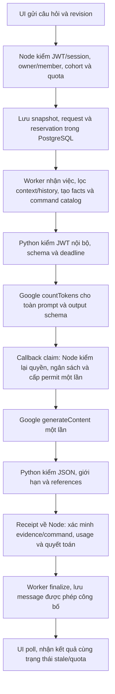

# Độ trễ AI Lab Assistant — 28/10/2026

## Kết luận

Phần lớn thời gian nằm ở bước đợi HTTP response từ Google. Thêm instrumentation
để tách rõ bước này; chưa có bằng chứng tối ưu ổn định bằng việc bỏ regex độ dài
khỏi schema. Đã trả schema về bản cũ sau thử nghiệm, không giữ một thay đổi chỉ
vì một mẫu nhanh hơn. Timeout55giây là trần thực thi, không phải thời gian phải
chờ đủ; tăng trần từ20giây chỉ tránh kết thúc request trước khi provider trả lời.

Mỗi request gọi đúng một `generateContent`. `countTokens` là bước preflight riêng;
không có nhiều vòng model tự gọi tools hoặc chạy lệnh CLI.

## Luồng đang chạy

UI poll thường2giây; worker idle poll1giây. Đây là độ chờ phát hiện/trả trạng thái,
không làm Google suy luận lâu hơn. Thời gian Node kiểm quyền/nhận request trước
`createdAt` và lần poll cuối của browser không nằm trọn trong số đo DB dưới đây.

## Số đo

Lượt live đầu thành công từ lần bật Gemini trước có tổng38,850s: queue0,057s,
chuẩn bị/preflight3,281s, dispatch→receipt34,206s, finalize1,306s. Mốc DB này
chưa tách riêng Google và receipt, không được gọi cả34,206s là GPU inference.

Đo thêm với cùng câu hỏi EXPLAIN_CONCEPT về default gateway, cùng ADMIN/attempt,
revision0 và cùng model/prompt/caps. History tăng giữa các request; input token
không giống hệt. Giới hạn3 generation mới để tiết kiệm ngân sách.

| Mốc | Schema gốc | Bỏ3 regex độ dài | Lặp lại bản bỏ regex |
| --- | ---: | ---: | ---: |
| Queue từ DB | 0,121s | ≈0s | ≈0s |
| Context + preflight + claim, DB | 3,689s | 3,297s | 3,125s |
| Google countTokens, Python | 0,408s | 0,262s | 0,225s |
| Callback claim, Python | 2,385s | 2,392s | 2,152s |
| Chờ Google response headers | **21,105s** | **10,270s** | **22,164s** |
| Nhận Google response body | 2,721ms | 2,258ms | 1,856ms |
| Callback receipt, Python | 1,227s | 1,613s | 1,048s |
| Finalize, DB | 1,303s | 1,622s | 1,092s |
| Tổng createdAt→finishedAt, DB | **27,880s** | **17,187s** | **27,709s** |
| Input/output/thinking token | 2122/196/0 | 2175/233/0 | 2231/226/0 |

Các mốc con nằm trong mốc cha, không cộng toàn bộ các hàng với nhau. `headers`
được đo bằng đồng hồ monotonic của Python; với API không streaming, đây là thời
gian chờ response, gồm mạng, xếp hàng/xử lý bên Google và sinh kết quả. Không có
telemetry nội bộ Google để tách các phần đó, không phải số đo token đầu tiên.
Body/parse/validation rất nhỏ; việc trả JSON qua loopback không phải nút thắt chính.

Queue raw của hai mẫu cuối là-17ms/-68ms giữa các timestamp DB, nên chỉ hiển thị
≈0; chưa dùng chúng để định lượng queue chính xác. Sai lệch nhỏ này không ảnh
hưởng kết luận dựa trên mốc monotonic21–22giây của Google. API admission và browser
render/poll chưa đo riêng, không gọi các tổng DB này là độ trễ browser hoàn chỉnh.

## Thử tối ưu và giới hạn kết luận

Thử bỏ riêng pattern độ dài cho summary/verification/step khỏi schema gửi Google,
vẫn giữ prompt/cap cùng toàn bộ validation Python và Node. Mẫu đầu nhanh hơn nhưng
mẫu xác nhận về gần baseline. Không đủ bằng chứng quy nguyên nhân cho regex hoặc
cam kết nhanh hơn; **đã hoàn nguyên phần tối ưu này**. Không đổi model, prompt
version, tier, số output token hoặc ngân sách để làm đẹp số đo.

Ba request đều `COMPLETED/LLM`, usage FINAL, replay cùng ID không gọi lại; state và
command log không đổi. Chi phí ghi nhận của3 lượt là3597micro-USD ($0,003597).
Ledger dùng chung tăng6→9 reservation, không reset và không retry generation.

Google [tài liệu structured output](https://ai.google.dev/gemini-api/docs/structured-output)
cho biết schema chỉ hỗ trợ một phần JSON Schema và cần kiểm giá trị tại ứng dụng;
`minLength`/`maxLength` không được enforce trong constrained decoding. Không được
bỏ validation local để lấy tốc độ. Thinking đã đặt `minimal`; cả ba lượt có
thinking0, nên chưa có căn cứ nói thinking là nguyên nhân chậm.

Các hướng tiếp theo cần benchmark riêng:

- Streaming: có thể hiển thị tiến trình sớm hơn, không tự giảm thời gian hoàn tất.
  Hiện app chỉ công bố output sau khi xác minh toàn bộ; cần thiết kế trạng thái
  draft riêng nếu thử streaming, không đưa text chưa xác minh thành kết luận lab.
- Đo model/tier khác với cùng context, giá và bộ câu hỏi khi chủ động chọn thử;
  không tự đổi provider/model hoặc tăng chi phí trong task này.
- Claim2,15–2,39s, receipt1,05–1,61s và finalize1,09–1,62s là phần overhead còn
  có thể nghiên cứu do callback và nhiều round trip tới DB từ xa. Cần giữ thứ tự
  lock, quyền hiện tại, idempotency và accounting khi gộp query; không bỏ permit.

## Đo lại và kiểm chứng

Đặt `AI_TRACE_TIMINGS=true` khi khởi động `pnpm ai:python` bằng launcher Node.
Nếu chạy Python trực tiếp, dùng `AI_PYTHON_TRACE_TIMINGS=true`. Mặc định false.
Log `ai.timing` chỉ có requestId/callId/phase/ms/outcome; không có prompt, key,
headers, response hoặc message exception. Context được tách theo async request.

309 test Python (gồm đo phase, log privacy, lỗi và nested scope),233 test AI Node,
lint/ruff/format/boundaries đạt. Integration PostgreSQL riêng17fresh+17upgrade+
46HTTP/lifecycle/Python tests đạt. Schema/claim/receipt/chi phí vẫn được kiểm;
không thêm test UI hoặc migration vì không thay UI/DB schema. Backend/Python/
worker/frontend giữ chạy, cluster DB test dừng sau kiểm.

Evidence local ở `.tmp/ai-latency-20261028/`: baseline/optimized/verify JSON,
các file tương ứng `*-phases.json` và probe. Request IDs lần lượt:
`f88db83f-408e-4929-8cdc-56ac3b7076f4`, `2facdf6a-6df1-434f-99c2-667bb40e798d`,
`e85fbfb1-a2c1-4b54-bbc0-a4a5043999d9`. Đây là3 mẫu, không phải benchmark p50/p95.
