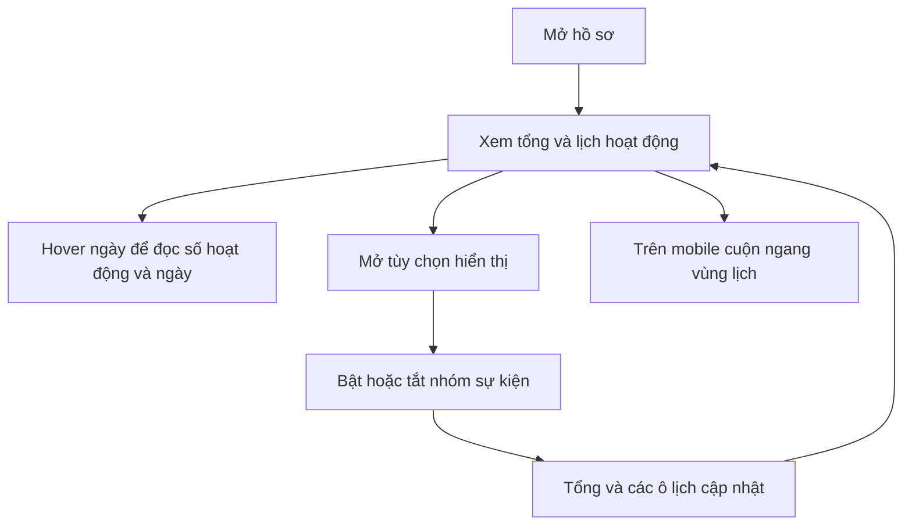
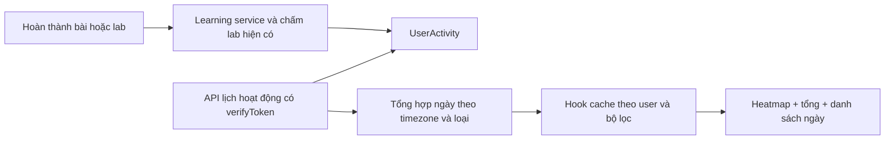

# REA — Lịch hoạt động trên hồ sơ F8

Ngày khảo sát: **28/10/2026**, múi giờ báo cáo **Asia/Ho_Chi_Minh**.
Tham chiếu: [hồ sơ F8 do người dùng cung cấp](https://f8.edu.vn/@diennhoc).
Phần phân tích: heatmap trong ảnh đính kèm, bước 0–3 theo quy trình phân tích feature của dự án.
Đích đối chiếu giả định: trang hồ sơ học tập `/profile` của NetMaster.

**Trạng thái 28/10/2026:** người dùng đã yêu cầu triển khai. Heatmap, API private
và kiểm thử đã có trong workspace; kết quả và các lần tinh chỉnh ở mục 10–12.

**Kết luận:** feature cho thấy phân bố hoạt động theo ngày và mức độ đều đặn.
NetMaster đã có nguồn sự kiện để làm bản đầu, nhưng API hồ sơ hiện tại không đủ
lịch sử 12 tháng. Khuyến nghị dựng component lịch riêng, thêm API tổng hợp theo
ngày từ backend; ưu tiên định nghĩa cách đếm trước khi làm màu sắc.

**Cập nhật vị trí theo ý kiến người dùng ngày 28/10/2026:** heatmap sẽ thay toàn
bộ card chào mừng `.profile-header` trong ảnh, ở đầu trang hồ sơ. Card hiện tại
gồm avatar, lời chào, level/streak và tổng tiến độ. Đây là điều chỉnh phương án
triển khai; chưa sửa giao diện trong lượt phân tích này.

Trong tài liệu: **[Xác nhận]** có bằng chứng UI/DOM hoặc code local;
**[Suy luận]** là cách giải thích chưa xác minh cơ chế bên trong;
**[Chưa biết]** cần quan sát hoặc quyết định bổ sung.
Mọi mục ghi **đề xuất** là phương án NetMaster, không phải mô tả backend F8.

## 1. Hiểu dự án trước khi đối chiếu

- [Xác nhận] Frontend React 18.3.1, React Router, CSS theo feature; profile tải
  qua route có `ProtectedRoute`, chưa phải hồ sơ công khai theo username.
- [Xác nhận] `Profile.js` đã có tổng thời gian, streak, biểu đồ điểm, biểu đồ
  thời gian tuần/tháng/quý và danh sách hoạt động gần đây. Recharts đã cài.
- [Xác nhận] API `/api/users/profile/me` dùng tài khoản hiện tại, trả tối đa
  **10 hoạt động trong 30 ngày**; không thể lấy mảng này để suy ra một năm.
- [Xác nhận] Backend Express, Prisma/PostgreSQL. `UserActivity` lưu loại sự
  kiện, `referenceId` và `createdAt`; `StudyLog` lưu số giây theo ngày.
- [Xác nhận] Learning service đã phát sự kiện hoàn thành bài/lab/chương/khóa.
  Ngày học video được chuẩn hóa theo `Asia/Ho_Chi_Minh` trước khi lưu `DATE`.
- [Xác nhận] Theo [hướng dẫn UI dự án](../ui-ux/student-ui-guidelines.md), khu
  học viên dùng Be Vietnam Pro, màu chính `#386298`, token sáng/tối và component
  chung. Mẫu F8 cần được diễn giải theo hệ giao diện này.

Nguồn local:
[Profile.js](../../src/frontend/src/features/profile/pages/Profile.js),
[routes users](../../src/backend/src/routes/users.js),
[userController.js](../../src/backend/src/controllers/userController.js),
[schema.prisma](../../src/backend/prisma/schema.prisma),
[learningPathService.js](../../src/backend/src/services/learningPathService.js).

## 2. Bằng chứng khảo sát và giới hạn

| Mã  | Nguồn/quan sát                                      | Điều xác nhận                                                                                                 |
| --- | --------------------------------------------------- | ------------------------------------------------------------------------------------------------------------- |
| E0  | Ảnh người dùng gửi                                  | Tiêu đề tổng, lịch ô vuông, nhãn tháng/thứ, thang xanh và năm 2026.                                           |
| E1  | DOM desktop tại URL tham chiếu                      | SVG lịch 768 × 113; 399 rect ngày trong vùng lịch, 5 rect chú giải riêng; nhãn từ Oct đến Oct và Mon/Wed/Fri. |
| E2  | Hover hai ô có màu                                  | Ngày 26/10/2026 có 7 hoạt động; ngày 27/10/2026 có 1; tổng tiêu đề là 8.                                      |
| E3  | Mở “Tùy chọn hiển thị”                              | Có 8 nhóm sự kiện, trong đó ba nhóm hiển thị hệ số ×2, ×3, ×5.                                                |
| E4  | Tắt/bật nhóm đăng nhập                              | Tổng 8 → 6; ô ngày chỉ có đăng nhập trở thành trống. Đã bật lại, xác nhận tổng trở về 8.                      |
| E5  | Override viewport 375 × 812, đọc DOM/computed style | Vùng lịch rộng 336px, nội dung cuộn rộng 768px, `overflow-x: auto`; danh sách năm `display: none`.            |
| E6  | DOM accessibility trong chart                       | Chưa có phần tử nhận focus trong vùng lịch; trigger tùy chọn là `div` không có role/tabindex.                 |

Selector quan sát: `[class*="heatmapTitle"]`, `[class*="heatmapRef"]`,
`.ch-subdomain-bg`, `[class*="heatmapYear"]`, `[role="tooltip"]`.
Tên class là bằng chứng cho bản khảo sát, không dùng làm selector của NetMaster.

Evidence local trong `.tmp/rea-f8-activity-20261028/`:
`desktop-observation.json`, `mobile-observation.json`, `behavior-observation.json`.
Số 404 trong quan sát mobile bao gồm các ô chú giải; không được hiểu là 404 ngày.
Các file này là dữ liệu tạm, không phải dependency của feature.

Giới hạn: thao tác chụp ảnh tự động timeout nên **không có ảnh mới được lưu**;
đối chiếu hình thức dựa ảnh E0 và DOM. Một thao tác lọc báo timeout nhưng đọc DOM
sau đó xác nhận đã thực hiện; đã kiểm trạng thái trước khi khôi phục. Đã reset
viewport, trả vị trí cuộn gần ban đầu và trả quyền điều khiển tab của người dùng.
Không đọc cookie/storage phiên, gọi endpoint riêng hoặc thu thập thông tin hồ sơ
ngoài dữ liệu cần cho feature. Chưa kiểm phiên không đăng nhập, phần cứng cảm ứng,
nhiều năm, tài khoản không hoạt động hoặc trạng thái lỗi của F8.

## 3. Feature vận hành thế nào?

### 3.1. Luồng người dùng



[Xác nhận] Cột tuần và hàng thứ tạo lịch dạng đóng góp, màu đậm biểu diễn mức
hoạt động cao hơn trong hai ngày đã kiểm. Tooltip cung cấp giá trị cụ thể.
Tổng 8 là tổng giá trị hoạt động đang chọn, **không phải 8 ngày hoạt động**;
hai ngày được quan sát có tổng 7 + 1.

[Xác nhận] Tùy chọn gồm: bài học hoàn thành, flashcards hoàn thành, đăng nhập,
câu trả lời hay nhất (×3), nhận chứng chỉ (×5), hỗ trợ cộng đồng, xuất bản blog
(×2), tạo thảo luận. Bộ lọc đăng nhập ảnh hưởng tổng và màu của ô ngày.

[Suy luận] Các hệ số cho thấy F8 có khái niệm hoạt động với trọng số, ngoài số
sự kiện thô. Chưa có mẫu sự kiện ×2/×3/×5 để xác nhận công thức tính thực tế.
Không nên khẳng định “mỗi thao tác tương đương một hoạt động”.

[Chưa biết] Ngưỡng chia màu, múi giờ gom ngày, cách xử lý trùng, công thức trọng
số và khoảng ngày chính xác. Nhãn Oct → Oct và 399 ô cho thấy có phần đệm lịch;
không suy từ số rect rằng dữ liệu bao phủ 399 ngày hoặc đúng 365 ngày.

### 3.2. Ma trận trạng thái

| Trạng thái           | F8 đã quan sát                                                     | Yêu cầu đề xuất cho NetMaster                                        |
| -------------------- | ------------------------------------------------------------------ | -------------------------------------------------------------------- |
| Có dữ liệu           | Hai ngày có màu, tổng 8.                                           | Tổng, số ngày hoạt động, chú giải và tooltip khớp dữ liệu server.    |
| Ngày không hoạt động | Các ô xám.                                                         | Phân biệt 0 với ngày chưa có dữ liệu lịch sử hoặc ngoài khoảng.      |
| Hover                | Tooltip số hoạt động + ngày bằng tiếng Anh trong trang tiếng Việt. | Ngày `vi-VN`, số lượng và phân loại có ý nghĩa.                      |
| Lọc loại             | Đăng nhập bật/tắt làm tổng 8 ↔ 6.                                  | Bộ lọc có label, trạng thái chọn và thao tác bàn phím.               |
| Nhiều năm            | Chỉ thấy 2026; chưa kiểm chuyển năm.                               | Chọn năm bằng control phù hợp cả desktop/mobile nếu có lịch sử.      |
| Mobile               | SVG giữ chiều rộng, vùng lịch cuộn ngang; năm bị ẩn.               | Cuộn trong card; vẫn truy cập được bộ lọc và năm; có danh sách ngày. |
| Loading              | Chưa ghi được trạng thái tải riêng của heatmap.                    | Skeleton giữ kích thước, tách khỏi loading toàn profile.             |
| Không có dữ liệu     | Chưa kiểm tài khoản rỗng.                                          | Thông báo trung tính và hành động học tiếp phù hợp.                  |
| Lỗi/offline          | Chưa quan sát.                                                     | Retry riêng; không biến lỗi tải thành 0 hoạt động.                   |
| Đổi tài khoản        | Chưa quan sát.                                                     | Hủy/bỏ response cũ, cache theo user và bộ lọc.                       |

### 3.3. Cây component suy ra từ giao diện

```text
ProfileActivitySection
├── Header: tổng + khoảng thời gian
├── ActivityTypeFilter
├── CalendarViewport
│   └── SVG: nhãn tháng, nhãn thứ, các ô ngày
├── ActivityTooltip
├── IntensityLegend
└── YearNavigation
```

Đây là phân rã để hiểu trách nhiệm, không phải tên component hoặc mã nguồn F8.
[Xác nhận] SVG và cấu trúc DOM hiện hữu. [Chưa biết] thư viện và phiên bản vẽ
lịch, framework thực thi riêng của feature, SSR/CSR, cache, debounce, request
API, analytics hay WebSocket/SSE. Chưa có network capture để mô tả method/path,
payload/status/header của F8; không đặt tên endpoint theo phỏng đoán.

## 4. Điểm tốt và điểm cần cải thiện

**Điểm tốt [quan sát + đánh giá]:** một khối nhỏ thể hiện cả năm, cho thấy ngày
học dày/thưa nhanh hơn danh sách dài; tổng và tooltip bổ sung số chính xác;
bộ lọc giúp phân biệt nhóm hoạt động. Đây là tín hiệu duy trì thói quen, chưa
chứng minh chất lượng kiến thức hay mức độ thành thạo.

**Điểm cần cải thiện [đề xuất]:**

- Ghi rõ “hoạt động” là sự kiện hay điểm có trọng số; thêm số ngày hoạt động
  để người học không nhầm tổng thao tác với sự đều đặn.
- Ô desktop đang đo 10 × 10px. Cần có cách đọc thay thế trên touch và bàn phím;
  không chỉ phóng 365 ô thành các nút 44px hoặc tạo 365 điểm Tab liên tiếp.
- Trigger tùy chọn hiện là `div` không có role/tabindex, ô lịch không có điểm
  focus trong DOM đã đo. Đây là rủi ro truy cập, chưa phải kết quả audit WCAG
  toàn trang. NetMaster nên có button, focus rõ, Escape và danh sách/bảng ngày.
- Tooltip nên dùng tiếng Việt đồng nhất. Thang màu nên giải thích được bằng số;
  bổ sung giá trị dạng chữ để người không phân biệt màu vẫn đọc được.
- Mobile cần gợi ý cuộn trong vùng lịch và giữ lựa chọn năm khả dụng; không để
  lịch đẩy tràn chiều ngang toàn trang.

Đã tra cứu UI/UX Pro Max bằng `heatmap calendar accessible --domain chart`:
kết quả phù hợp là Heatmap/Intensity, nhấn mạnh bảng/danh sách và giá trị hỗ trợ
ngoài màu. Query `heatmap keyboard focus --domain ux` trả hướng dẫn focus chung;
chỉ dùng cho focus, không coi đó là xác minh một chuẩn tương tác heatmap cụ thể.
Không áp máy móc ngưỡng 365 ô của kết quả tra cứu vào năm nhuận/phần đệm lịch.

## 5. Khoảng cách với NetMaster

| Nội dung           | Hiện có trong dự án [xác nhận code]                                                                                  | Việc cần làm [đề xuất]                                                                                                   |
| ------------------ | -------------------------------------------------------------------------------------------------------------------- | ------------------------------------------------------------------------------------------------------------------------ |
| Lịch một năm       | Chưa có heatmap; đầu profile là card chào mừng `.profile-header`.                                                    | Thay toàn bộ card chào mừng bằng heatmap ở cùng vị trí đầu trang.                                                        |
| Lịch sử hoạt động  | `UserActivity` có timestamp/type/reference; profile giới hạn 30 ngày/10 bản ghi.                                     | API tổng hợp theo ngày độc lập, không ghép từ feed đã giới hạn.                                                          |
| Sự kiện học        | Có lesson/lab/module/course completion.                                                                              | Bản đầu chỉ đếm lesson/lab; tránh một bài cuối vừa tăng bài, chương và khóa.                                             |
| Thời gian học      | `StudyLog` có giây/ngày và unique user/date.                                                                         | Có thể làm chỉ số riêng; không cộng phút vào số hoạt động.                                                               |
| Bài thi            | `ExamResult.takenAt` có lịch sử; UI có nhãn EXAM nhưng chưa thấy producer UserActivity tương ứng trong nguồn đã đọc. | Nếu mở bộ lọc bài thi, tổng hợp từ ExamResult hoặc bổ sung producer có idempotency; không suy từ nhãn UI rằng log đã có. |
| Streak             | Profile đọc `User.streak`; lab achievements có cách tính riêng từ ngày PASSED.                                       | Chốt định nghĩa chung trước khi ghép streak mới; bản đầu chưa đổi streak đang có.                                        |
| Ngày và quyền      | `verifyToken`, StudyLog dùng ngày Việt Nam.                                                                          | Gom timestamp UserActivity bằng cùng timezone, lọc theo req.user.id.                                                     |
| Chất lượng dữ liệu | Không có unique/index user/date/type riêng trên UserActivity trong Prisma hiện tại.                                  | Kiểm dữ liệu trùng và query plan trên DB thử trước khi quyết định index/migration.                                       |

### Vị trí và phạm vi thay card

Theo ảnh và ý kiến người dùng, heatmap chiếm hàng đầu và toàn bộ chiều ngang
grid hiện dành cho `.profile-header`. Khi triển khai, bỏ nội dung avatar, lời
chào, level/streak và tổng tiến độ của card cũ khỏi khối này.

Bố cục đề xuất: tiêu đề **“Hoạt động học tập”** và tổng trong khoảng đang xem ở
trên; bộ lọc và chọn năm ở phía phải trên desktop; lịch ở giữa; chú giải màu ở
dưới. Mobile xếp các điều khiển theo chiều dọc và cuộn ngang riêng vùng lịch.
Màu, typography và trạng thái dùng token profile hiện có.

Giữ một heading chính của trang khi bỏ lời chào `h1`: có thể dùng “Hoạt động
học tập” làm `h1` của khối mới. Loading/rỗng/lỗi của lịch vẫn chiếm vùng này.
Phạm vi thay thế chỉ là card trong ảnh; bốn metric và các khối biểu đồ/feed
phía dưới tiếp tục theo bố cục profile hiện tại. Không xóa dữ liệu avatar,
level/streak hoặc tiến độ khỏi backend chỉ vì bỏ chúng khỏi card này.

### Quy tắc đếm khuyến nghị cho bản đầu

**Đề xuất:** metric `completion_count`, một lần hoàn thành bài hoặc lab hợp lệ
lần đầu tương đương một sự kiện. Learning service đã phát log theo
`firstCompletion`; cần kiểm các writer/legacy/duplicate trước khi coi lịch sử
hoàn toàn sạch. Không tính đăng nhập, heartbeat video, từng lệnh CLI hoặc các
mốc chương/khóa cùng ngày vào metric này.

Tổng là số completion trong khoảng, số ngày hoạt động là số ngày có count > 0.
Lọc bài/lab phải cập nhật cả tổng, màu và danh sách ngày. Chưa đưa điểm trọng số
vào bản đầu. Nếu cần nhánh bài thi sau này, định nghĩa đếm theo attempt hay lần
vượt qua đầu tiên và chống spam nộp lặp trước khi mở.

Không tạo lại lịch sử đã mất từ `updatedAt` hoặc nhân ngược từ tổng tiến độ.
Ngày trước khi có tracking/chưa rõ độ đầy đủ cần hiển thị trạng thái “chưa có
dữ liệu”, thay vì chắc chắn kết luận người học không làm gì.

## 6. Luồng dữ liệu và API đề xuất



**Endpoint mới đề xuất:**
`GET /api/users/stats/activity-calendar?range=last365&type=all`.
Khi chọn năm: `range=year&year=2026`. `type` chỉ nhận `all|lesson|lab`.
Không nhận userId tùy ý; đây là hồ sơ riêng hiện có, chưa mở public profile.

Response tối thiểu gồm `metric`, `timeZone`, `from`, `to`, `total`,
`activeDays`, `levels`, `days[]` với `date`, `count`, phân loại lesson/lab và
metadata độ đầy đủ lịch sử. Ví dụ hợp đồng, **không phải dữ liệu người học**:

```json
{
  "metric": "completion_count",
  "timeZone": "Asia/Ho_Chi_Minh",
  "from": "2025-10-29",
  "to": "2026-10-28",
  "total": 3,
  "activeDays": 1,
  "levels": [0, 1, 3, 5, 8],
  "historyCompleteness": "unknown",
  "days": [{ "date": "2026-10-28", "count": 3, "lesson": 2, "lab": 1 }]
}
```

`days` là các ngày có sự kiện; UI tạo đủ ô lịch. Chỉ bù 0 ở vùng lịch sử đã xác
nhận đầy đủ; ngày chưa biết dùng trạng thái riêng. Các ngưỡng trong `levels` là
đề xuất, cần chốt và giữ ổn định giữa bộ lọc để so sánh được. API trả ngưỡng
để client không tự suy ra scale khác.

`last365` phải có nhãn “365 ngày qua”; chọn năm là năm lịch, hỗ trợ 366 ngày và
ô đệm tuần, ngày tương lai không tính. Quy ước tuần bắt đầu thứ Hai cho NetMaster
và ghi rõ ngày Việt Nam; không lấy `getDay()` theo TZ máy chủ để chia ngày.
Cache theo user/range/year/type; refresh sau completion, bỏ response của tài
khoản cũ. Request sai năm/loại trả lỗi rõ; lỗi server không đổi thành mảng rỗng.

## 7. Phương án triển khai và khuyến nghị

| Phương án                                         | Ưu điểm                                                                                        | Đánh đổi                                                                                          |
| ------------------------------------------------- | ---------------------------------------------------------------------------------------------- | ------------------------------------------------------------------------------------------------- |
| A — Một năm thời gian học từ StudyLog             | Nguồn giây/ngày và khóa unique đã có; dễ tổng hợp.                                             | Chỉ phản ánh tracking video đang có; phải đặt tên lịch thời gian học, không gọi là mọi hoạt động. |
| **B — Lịch hoàn thành bài/lab từ UserActivity**   | Gần nhu cầu ảnh, phản ánh kết quả học, tận dụng producer hiện có; không cần dependency UI mới. | Phải kiểm duplicate/coverage, thêm API tổng hợp; chưa bao gồm bài thi.                            |
| C — Ledger hoạt động thống nhất bài/video/lab/thi | Phạm vi rộng, hỗ trợ rule/version/idempotency dài hạn.                                         | Thêm mô hình dữ liệu, migration, nhiều producer và vận hành; vượt phạm vi bản đầu.                |

**Chọn B cho bản đầu.** Dùng React và CSS Grid hoặc SVG tự viết, giới hạn vài
trăm ô, component tách khỏi Profile; không cần cài D3/Cal-Heatmap chỉ để vẽ lịch.
Recharts hiện có tiếp tục phục vụ biểu đồ điểm/thời gian. Đây là khuyến nghị
triển khai, chưa thực hiện thay đổi nào trong runtime.

Ưu tiên theo tác động/công sức:

1. **Cao / vừa:** hợp đồng đếm, timezone, quyền, coverage, dedupe và API năm.
2. **Cao / vừa:** lịch, tổng, tooltip, danh sách ngày; desktop/mobile, keyboard,
   theme sáng/tối. Mục tiêu WCAG 2.2 AA cần kiểm hành vi và độ tương phản thật.
3. **Vừa / thấp–vừa:** lọc bài/lab, chọn năm, hiển thị ngày hoạt động, retry riêng.
4. **Sau bản đầu / cao:** thêm bài thi, trọng số hoặc thống nhất streak/ledger.

## 8. File dự kiến, kiểm chứng và rollback

Nếu triển khai phương án B, dự kiến:

- Tạo `src/frontend/src/features/profile/components/ActivityCalendar.jsx`,
  hook `hooks/useActivityCalendar.js`, helper lịch và CSS scoped theo profile.
- Sửa `Profile.js`, `Profile.css`, `src/frontend/src/services/Api.js` để thay
  `.profile-header` bằng lịch và gọi API; dọn selector/import chỉ phục vụ card
  cũ khi không còn nơi dùng; tái dùng control/StatusAlert hiện có.
- Sửa `src/backend/src/routes/users.js`, `controllers/userController.js`;
  tách service tổng hợp ngày nếu cần. Chỉ bổ sung index/migration khi có bằng
  chứng hiệu năng hoặc yêu cầu uniqueness đã chốt; chưa thay schema ở bản phân tích.
- Bổ sung kiểm helper lịch, UI và API phù hợp trong cấu trúc test hiện có;
  cập nhật `Profile.test.jsx` đang tìm heading lời chào sang heading mới và
  kiểm card cũ được thay đúng vị trí. Cập nhật hướng dẫn UI sau browser thật.

**Dependency mới đề xuất:** không có. **Bảo mật:** endpoint private, chỉ dữ liệu
của tài khoản hiện tại; response không mang email/title cá nhân hoặc snapshot
lab; không dùng endpoint/token/asset/code F8 trong sản phẩm NetMaster.

**Kiểm bắt buộc khi triển khai:**

- Heatmap thay đúng card đầu trang trong ảnh, có heading chính phù hợp và
  không làm xê dịch thứ tự các khối metric/biểu đồ/feed bên dưới.
- Hai user có lịch tách biệt; đổi account lúc request đang chờ không rò dữ liệu.
- Completion lặp không tăng count; bài cuối chương không đếm thêm hai mốc.
- Tổng, activeDays, tooltip và lọc khớp; data gap khác 0; lỗi khác rỗng.
- Ranh giới ngày 00:00 Việt Nam, giao năm, năm nhuận, ô đệm và ngày tương lai.
- Bộ lọc hoạt động bằng bàn phím; tooltip có đường đọc bằng focus/danh sách;
  không có bẫy focus hoặc hàng trăm điểm Tab; control có tên và focus rõ.
- Browser 375/768/desktop, sáng/tối, nội dung dài; không tràn toàn trang,
  không dịch chuyển khi tải, không bắt buộc animation để đọc dữ liệu.
- Query có giới hạn thời gian/phạm vi, kiểm query plan trên dữ liệu thử;
  chưa có phép đo LCP/CLS/INP hoặc benchmark để khẳng định hiệu năng hiện tại.

**Rollback đề xuất:** khôi phục card `.profile-header` cùng CSS/test tương ứng
từ thay đổi triển khai và tắt endpoint mới khi cần; không để trống hàng đầu
trang. Không thay producer đang hoạt động chỉ để rollback UI. Nếu triển khai có
index hoặc schema riêng, lập kế hoạch migration/rollback cụ thể trước bước đó.

## 9. Những điều còn chưa biết và điểm dừng

- [Chưa biết — F8] Công thức trọng số/ngưỡng màu, query API/cache và múi giờ;
  năm cũ, lịch rỗng, lỗi, click ngày/touch, full keyboard và SEO của khối lịch.
- [Chưa biết — NetMaster] Độ đầy đủ/duplicate của dữ liệu lịch sử thực tế và
  hiệu năng truy vấn; báo cáo này chỉ đọc source, không truy cập DB người học.
- [Đã có định hướng từ người dùng] Thay card chào mừng đầu profile bằng heatmap.
- [Đã chốt khi triển khai] `completion_count` cho bài/lab, mặc định365ngày
  hoặc chọn năm; ngày thiếu lịch sử có trạng thái “chưa ghi nhận”.

Các mục trên ghi lại khảo sát và phương án đã được duyệt. Phần triển khai theo
yêu cầu tiếp theo được cập nhật bên dưới. Không sao chép mã/asset của F8.

## 10. Triển khai trong workspace — 28/10/2026

### Hành vi đã có

- Card `ActivityCalendar` thay toàn bộ `.profile-header` ở hàng đầu profile,
  dùng token sáng/tối, heading chính “Hoạt động học tập”; các metric và khối
  biểu đồ/feed tiếp tục ở phía dưới. CSS và import chỉ phục vụ header cũ đã bỏ.
- Mặc định 365 ngày qua; chọn năm gồm năm nhuận và năm hiện tại đến hôm nay.
  Năm khả dụng dựa ngày tạo tài khoản, không hiển thị năm tương lai. Có bộ lọc
  bài học/lab, tổng completion và số ngày có completion.
- Ô ngày có tooltip native bằng tiếng Việt và dòng chi tiết khi hover/focus/tap.
  Lịch có một điểm Tab, phím mũi tên di chuyển theo bố cục tuần, Home/End tới
  đầu/cuối khoảng. “Xem theo ngày” cung cấp lịch riêng và danh sách phân trang
  5 ngày; có thể chọn bất kỳ ngày trong khoảng để đọc chi tiết.
- Vùng lịch cuộn ngang riêng, mở ở ngày đang chọn (ban đầu là ngày gần nhất).
  Loading/rỗng/lỗi có trạng thái riêng, retry riêng; không dựng dữ liệu giả
  trong UI sản phẩm. Tái tải khi quay lại cửa sổ; response cũ bị bỏ và request
  được abort khi đổi bộ lọc/tài khoản hoặc unmount.

### Dữ liệu và quyền

Endpoint thật: `GET /api/users/stats/activity-calendar`, cùng query contract
ở mục 6, qua `verifyToken`, phản hồi `Cache-Control: private, no-store`.
Identity lấy từ `req.user.id`; query thừa hoặc sai khoảng/năm/loại bị từ chối.
Response thêm `range`, `type`, `today`, `availableYears` bên cạnh các trường
đã đề xuất; `historyCompleteness` hiện trả `unknown`.

Service lấy `MIN(created_at)` theo `(type, reference_id)` của đúng user trước
khi lọc khoảng ngày. Vì vậy duplicate trong năm nay của completion năm trước
không được tính lại. Chỉ tính lesson/lab có reference dương; bỏ log legacy
thiếu reference, module/course, đăng nhập và sự kiện khác. Không gọi model AI.

Timestamp UTC của schema được chuyển sang ngày Việt Nam bằng phép
[AT TIME ZONE của PostgreSQL](https://www.postgresql.org/docs/current/functions-datetime.html).
Không tính timestamp tương lai, không lấy timezone máy chủ để chia ngày.
Ngày vắng bản ghi có giá trị hiển thị “chưa ghi nhận”, không suy ra lịch sử
hoàn chỉnh hoặc backfill từ tiến độ hiện tại. Chưa thêm index/schema/migration.

### File và kiểm chứng

Code chính:
[backend service](../../src/backend/src/profile/activityCalendar.js),
[card](../../src/frontend/src/features/profile/components/ActivityCalendar.jsx),
[hook](../../src/frontend/src/features/profile/hooks/useActivityCalendar.js),
[helper ngày](../../src/frontend/src/features/profile/utils/activityCalendar.js).
Điểm nối nằm ở userController/routes, Api.js và Profile.js.

- **Frontend:** 3 suite/8 test đạt, gồm helper năm nhuận/unknown/0, keyboard,
  retry, thay header và response đến muộn của account/filter cũ.
- **PostgreSQL/HTTP:** 6 test/subtest đạt trên DB thử được cấp riêng bằng
  migration hiện có. Kiểm trùng trong/ngoài khoảng, cùng reference khác loại,
  mốc 00:00 Việt Nam, năm nhuận, log không hợp lệ, owner/session và query sai.
  DB thử đã xóa đúng database do runner tạo; không dùng DB ứng dụng.
- **Hồi quy core:** 9 đạt/3 integration opt-in skip trong `pnpm test:core`;
  test profile đã được đưa vào script này để CI dùng flag integration hiện có.
- ESLint phần thay đổi đạt; build production đạt; boundaries đạt. Không thêm
  dependency hoặc thay lockfile. Có cảnh báo deprecation `fs.F_OK` từ tooling.
- **Browser:** dùng production build với API/tài khoản tổng hợp ở preview riêng,
  đăng nhập qua UI; kiểm sáng/tối, desktop và 375px, lọc lab, năm 2024 có 366 ô,
  phím mũi tên, trạng thái rỗng và 503 → retry. Mobile không tràn document,
  hai control lọc cao44px. Đây không phải xác nhận dữ liệu tài khoản thật.

Evidence và runner local ở `.tmp/profile-activity-20261028/`; migration log,
integration log, ảnh desktop/mobile và metadata browser được giữ tại đó.
Chưa chạy load benchmark, audit screen reader đầy đủ hoặc thiết bị touch thật;
chưa chứng nhận độ đầy đủ của lịch sử production. Tác vụ không commit/push/deploy.

## 11. Tinh chỉnh theo ảnh và phản hồi người dùng — 28/10/2026

- Đã đọc trực tiếp palette legend F8: `#ebedf0`, `#9be9a8`, `#40c463`,
  `#30a14e`, `#216e39`. Giữ nguyên cho heatmap ở cả hai theme; ô ngày trống
  dùng `#ededed` đúng quan sát chart. Đây là lựa chọn màu được người dùng chốt.
- Giảm font heatmap: tiêu đề18px desktop/16px mobile, tổng13px/12px; giảm
  khoảng cách phần đầu. Mobile375px đo card khoảng427px so với525px trước đó.
- Bốn metric xếp2cột trên mobile; font nhãn12px, số20px, đơn vị11px. Ở375px,
  mỗi ô đo khoảng151×82px; hàng1 và hàng2 chứa đúng2ô, document không tràn.
- Thay `<details>` bằng accordion grid0fr/1fr có chevron/opacity transition;
  điều khiển ẩn được `inert`/`aria-hidden` ngay khi đóng. Danh sách mỗi trang
  5ngày, hàng gọn gồm ngày/số lượt/phân loại, có nút trước/sau. Metric có hiệu
  ứng vào lần đầu và list đổi trang có reveal nhẹ; hỗ trợ reduced motion.
- Bỏ `<input type="date">`; component `ActivityDatePicker` dùng Dialog chung,
  calendar thứHaiđầu tuần, chọn tháng/năm riêng, mũi tên/PageUp/PageDown,
  giới hạn min/max và ngày nhuận. Có animation mở/đóng; Escape/backdrop và chọn
  ngày đều khôi phục focus về nút mở lịch. Không thêm dependency.
- Khi resize, vùng lịch tự giữ ngày đang chọn trong khung cuộn của chính nó.

Các component/style mới được giới hạn trong feature profile, API/schema không
đổi. Kiểm16test thuộc5suite (profile, helper, date picker và Dialog) đạt, gồm
phân trang, giới hạn tháng/năm, năm nhuận, focus sau chọn ngày và đóng ngay khi
reduced motion. Lint/build/boundary/icon và kiểm browser được ghi trong todo;
ảnh/metadata tại `.tmp/profile-refine-20261028/`. Browser dùng dữ liệu tổng hợp;
không coi kiểm viewport là kiểm thiết bị touch hoặc screen reader thật.

## 12. Bổ sung typography cho dropdown và các thẻ profile — 28/10/2026

Phản hồi ảnh mới chỉ ra chữ của menu mở và các section bên dưới vẫn lớn.
Nguyên nhân: portal của DropdownSelect không kế thừa typography từ trigger;
các heading `h2` chưa có cỡ chữ riêng; vùng chart rỗng vẫn giữ chiều cao biểu
đồ; khối empty-state dạng hàng bó hẹp chữ và nút trên mobile.

- DropdownSelect truyền font family/size/weight/line-height/letter-spacing đã
  resolve từ trigger tới menu, cùng cơ chế màu hiện có. Menu heatmap dùng
  cỡ chữ12px trên mobile và minimum168px qua CSS variable của feature.
- Heading section16px desktop/15px mobile; nội dung rỗng13px/12px. Thu gọn
  padding, icon và nút; áp trực tiếp cho h2 thay vì chỉ container bao ngoài.
- Vùng biểu đồ chưa có dữ liệu hoặc lỗi co theo nội dung, min-height90px;
  khi có dữ liệu vẫn260px. Không thay số liệu hoặc logic tổng hợp.
- Header thời gian học và nhóm tuần/tháng chuyển từ inline style sang class
  có scope. Mobile đặt nhóm chọn khoảng dưới tiêu đề; empty-state rộng xếp
  dọc để nút không bị ép thành nhiều dòng hẹp.

Kiểm trực tiếp375px với dữ liệu tổng hợp: năm heading đều15px và cao21px,
thông báo rỗng12px, menu/label12px; hai vùng chart rỗng90px. Khi có dữ liệu,
cả hai chart260px và trang không tràn. Test profile/calendar/datepicker/Dialog
và DropdownSelect:6suite/18test đạt. Evidence bổ sung tại
`.tmp/profile-type-20261028/`; giữ nguyên backend, palette và schema.
